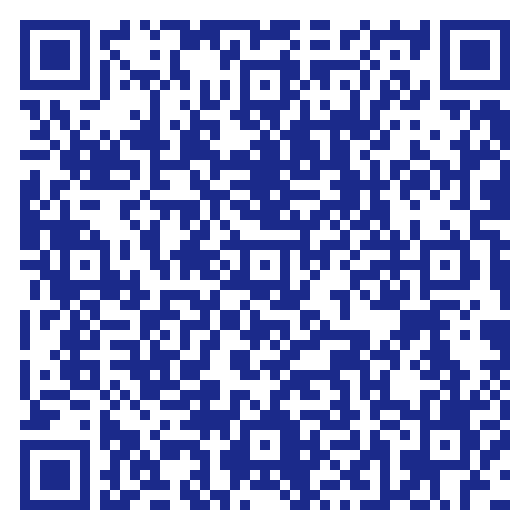

::: contact-grid
::: {}
## Lab address

**Quantitative Conservation Biology Lab**\
Prof. Nicolas Schtickzelle

UCLouvain\
Earth and Life Institute — Ecology & Biodiversity

Croix du Sud 4, L7.07.04\
1348 Ottignies-Louvain-la-Neuve\
Belgium
:::

::: {}
## Get in touch

**Email:** [nicolas.schtickzelle \[at\] uclouvain.be](#email)

**Phone:** +32 10 47 20 52

**Office:** Carnoy building, room c.157

{fig-alt="QR code with my contact details (vCard)" width="150"}

*Scan to add me to your contacts, or [download my contact card](assets/files/nicolas-schtickzelle.vcf)*
:::
:::

## Find us



[Open in OpenStreetMap](https://www.openstreetmap.org/?mlat=50.66662&mlon=4.61937#map=18/50.66662/4.61937) ·
[Open in Google Maps](https://www.google.com/maps/search/?api=1&query=Croix+du+Sud+4,+1348+Louvain-la-Neuve,+Belgium)
