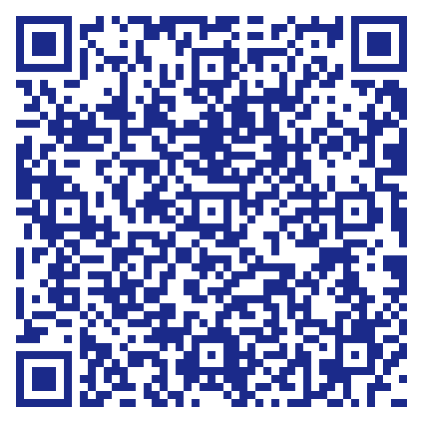

<!-- GENERATED FILE — do not edit.
     Source: ../contact.qmd + ../data/translations.fr.json
     Regenerate with: python tools/build_french.py -->
---
title: "Contact"
pagetitle: "Contact"
description: "Adresse et plan d'accès à notre laboratoire."
---

::: contact-grid
::: {}
## Adresse

**Quantitative Conservation Biology Lab**\
Prof. Nicolas Schtickzelle

UCLouvain\
Earth and Life Institute — Ecologie & Biodiversité

Croix du Sud 4, L7.07.04\
1348 Ottignies-Louvain-la-Neuve\
Belgique
:::

::: {}
## Contactez-moi

**Email :** [nicolas.schtickzelle \[at\] uclouvain.be](#email)

**Téléphone :** +32 10 47 20 52

**Bureau :** bâtiment Carnoy, local c.157

{fig-alt="QR code with contact details" width="140"}

*Mes coordonnées dans une vCard*
:::
:::

## Plan d'accès

<iframe class="map-embed" title="Map to the Quantitative Conservation Biology Lab" loading="lazy" referrerpolicy="no-referrer-when-downgrade" src="https://www.openstreetmap.org/export/embed.html?bbox=4.6130%2C50.6635%2C4.6260%2C50.6698&layer=mapnik&marker=50.66662%2C4.61937"></iframe>

[Ouvrir dans OpenStreetMap](https://www.openstreetmap.org/?mlat=50.66662&mlon=4.61937#map=18/50.66662/4.61937) · [Ouvrir dans Google Maps](https://www.google.com/maps/search/?api=1&query=Croix+du+Sud+4,+1348+Louvain-la-Neuve,+Belgium)
