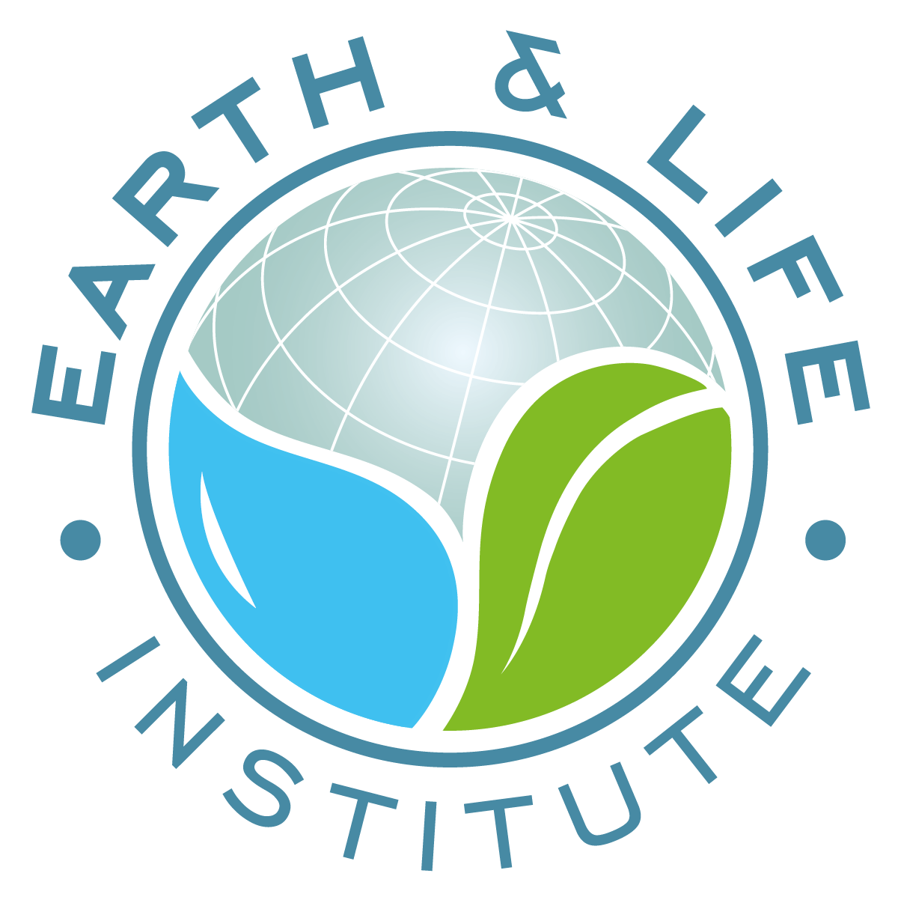
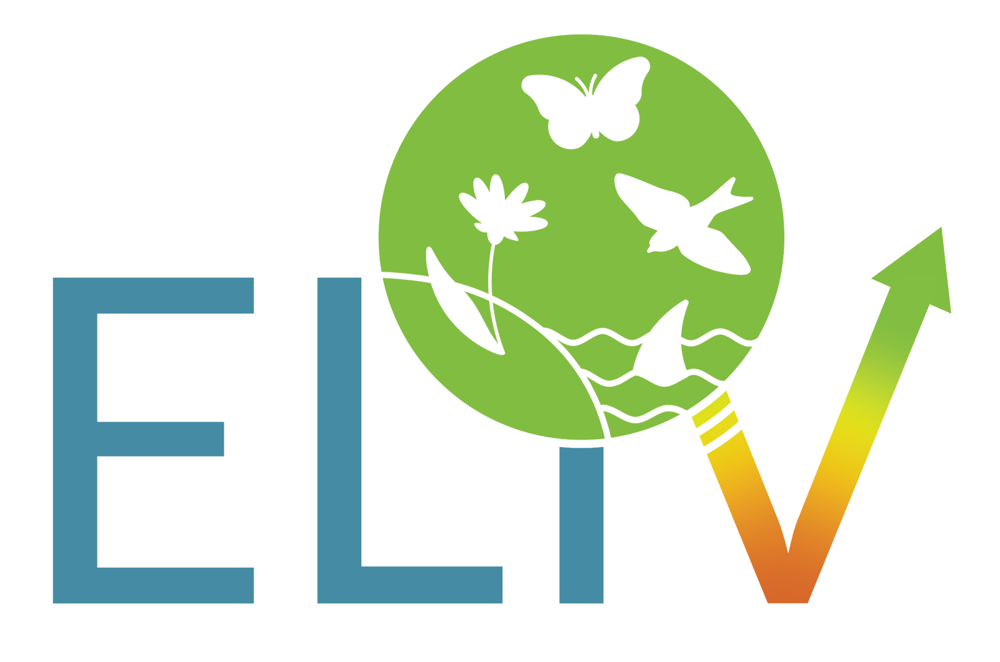
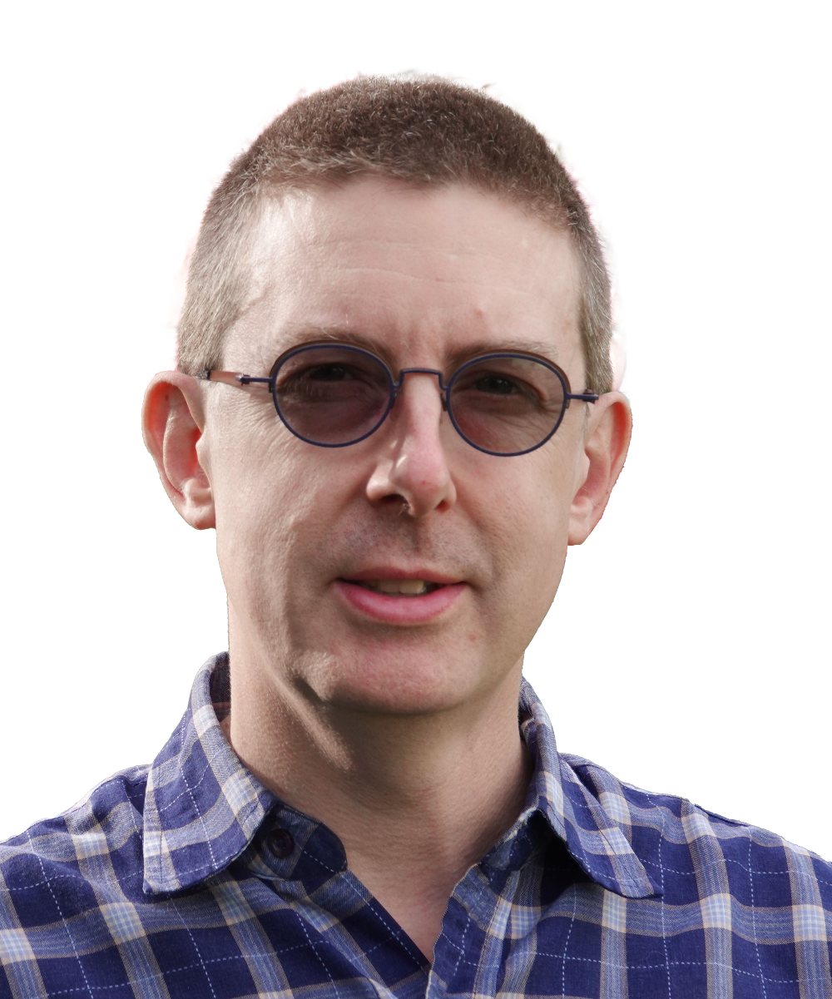
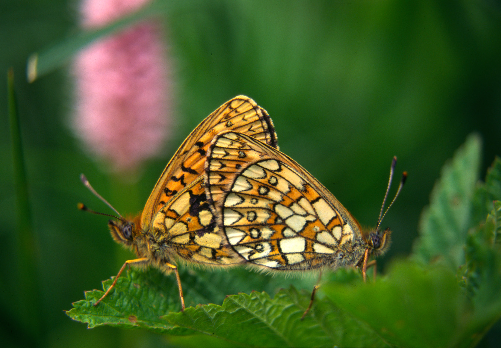
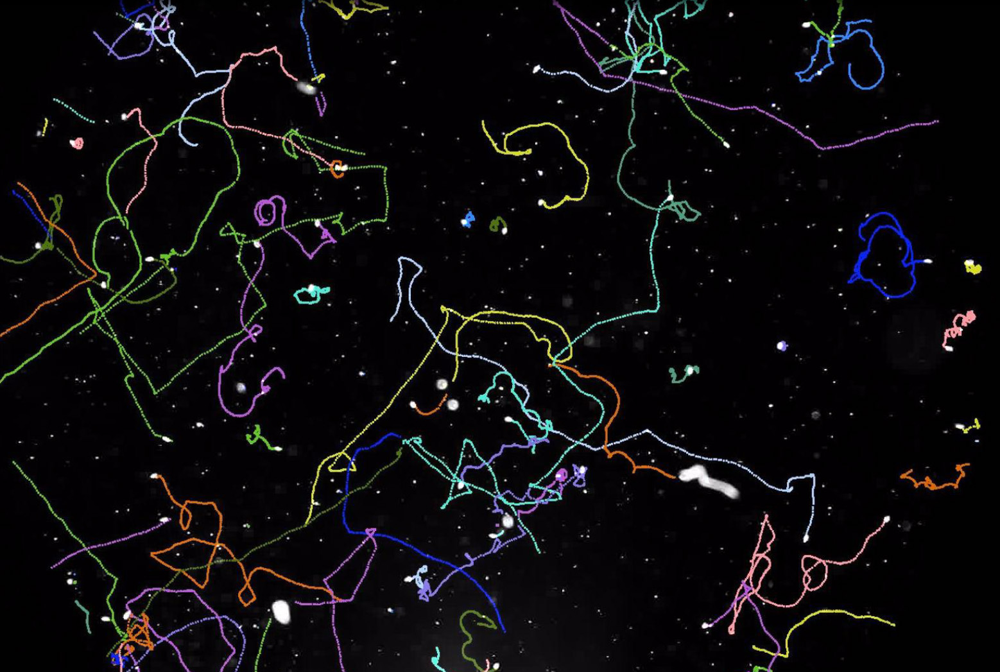
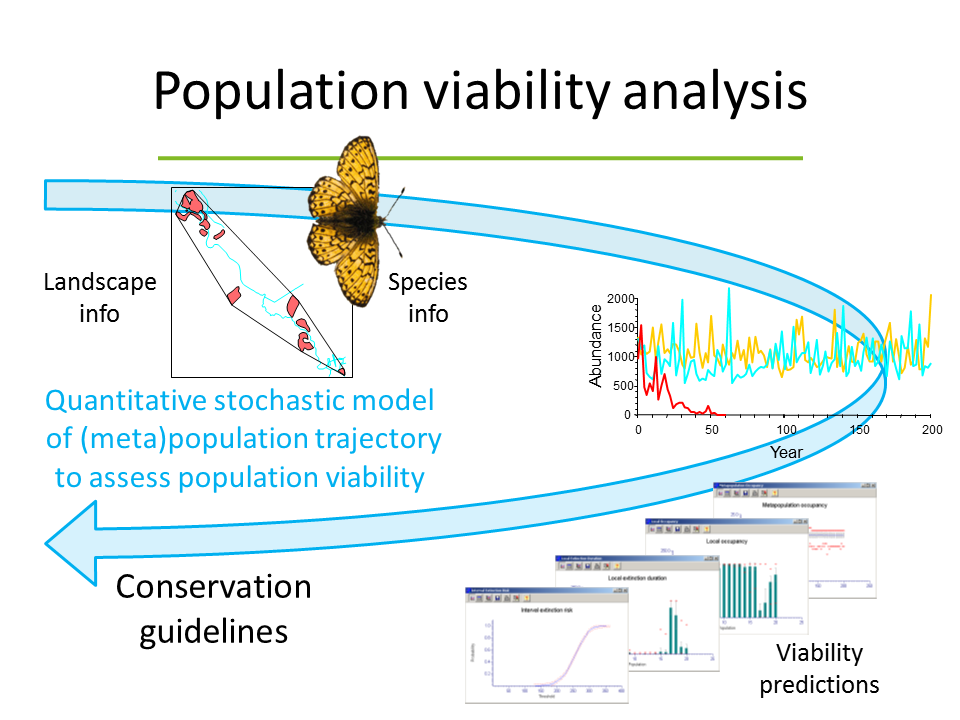
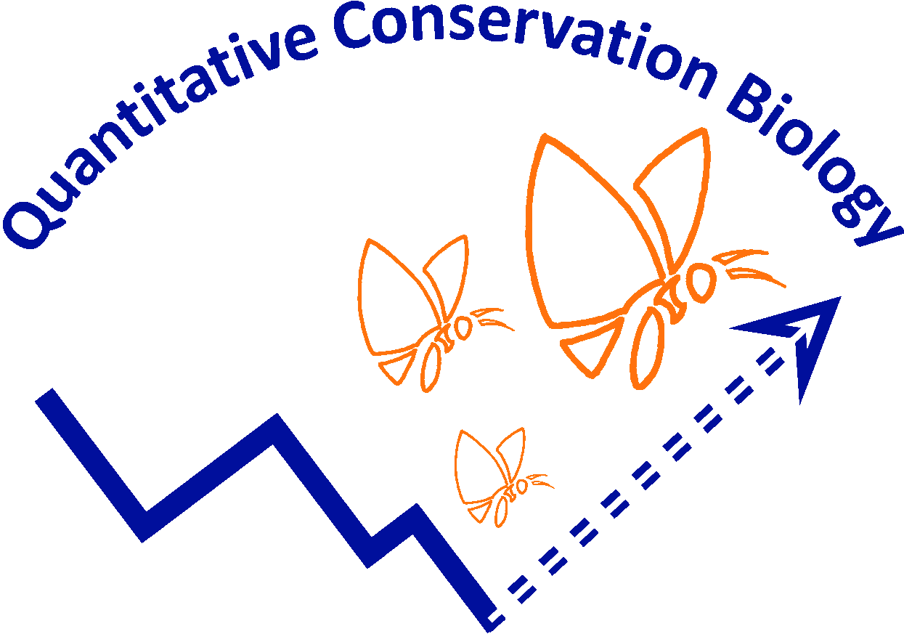

<!-- GENERATED FILE — do not edit.
     Source: ../index.qmd + ../data/translations.fr.json
     Regenerate with: python tools/build_french.py -->
---
pagetitle: "Professeur d'Ecologie Quantitative et Biologie de la Conservation"
description: "«Comment les animaux réagissent-ils aux changements environnementaux globaux?» est le centre de mes recherches utilisant des papillons sur le terrain et des organismes unicellulaires dans des microcosmes de laboratoire."
---

::: {.hero .hero-photo style="background-image: url('../assets/img/hero-boloria.jpg')"}
# Chercheur et Professeur en écologie quantitative et biologie de la conservation

::: tagline
UCLouvain (Louvain-la-Neuve, Belgique)\
Earth and Life Institute · Ecologie et Biodiversité
:::

::: hero-logos
[{fig-alt="UCLouvain"}](https://uclouvain.be/en/index.html)
[{fig-alt="Earth and Life Institute"}](https://uclouvain.be/en/research-institutes/eli)
[{fig-alt="ELI Ecology and Biodiversity"}](https://uclouvain.be/en/research-institutes/eli/ecology-and-biodiversity)
:::
:::

::: home-lead
{fig-alt="Portrait of Nicolas Schtickzelle"}

::: {}
**Comment les populations réagissent-elles aux changements environnementaux globaux, et qu'est-ce que cela implique pour leur viabilité à long terme ?** Cette question guide mes recherches en écologie quantitative et en biologie de la conservation.

[En savoir plus : bio en bref et carrière →](short-bio.qmd)
:::
:::

## Recherche

::: home-cards
::: home-card
{fig-alt="Boloria eunomia butterflies mating"}

### Papillons sur le terrain

Suivi à long terme et capture–marquage–recapture du nacré de la bistorte *Boloria eunomia* en Belgique depuis 1992 : dynamique de métapopulation et déplacements.
:::

::: home-card
{fig-alt="Tetrahymena thermophila movement trajectories"}

### Protistes en microcosmes

Expériences en laboratoire avec le cilié *Tetrahymena thermophila* pour étudier les causes et les conséquences de la dispersion.
:::

::: home-card
{fig-alt="Population viability analysis as a crystal ball"}

### Modélisation quantitative

Analyse de viabilité des populations pour prédire la persistance des espèces, et nouvelles méthodes pour la recherche en écologie.
:::
:::

[Tous mes thèmes de recherche →](research-interests.qmd){.home-more}

## Le groupe Quantitative Conservation Biology

::: theme
::: {}
Nous sommes une petite équipe collaborative qui étudie comment les populations font face à la fragmentation des habitats
et aux changements globaux, à travers la dispersion, la dynamique des métapopulations et la viabilité des populations.
Nous combinons l'étude de papillons sur le terrain, des expériences en laboratoire avec des protistes en microcosmes
et la modélisation quantitative pour comprendre ces processus et contribuer à inverser le déclin de la biodiversité.

À ce jour : 7 thèses de doctorat terminées et 4 en cours, 8 postdocs et 50 mémoires de master encadrés.

[Découvrir l'équipe et nos anciens →](mentoring.qmd){.home-more}
:::

{fig-alt="Quantitative Conservation Biology group logo"}
:::

## Dernières publications



[Toutes les publications et la bibliométrie →](publications.qmd){.home-more}

## Enseignement

J'enseigne les statistiques, l'analyse de données, la biologie de la conservation et la démarche scientifique aux étudiants de bachelier et de master en biologie à l'UCLouvain : *Principes de statistiques et analyse des données biologiques* (LBIO1283), *Conservation de la biodiversité* (LBOE2120), *Démarche scientifique en biologie* (LBIO1116) et *Analyse de données et modélisation des systèmes biologiques* (LBOE2112).

[Détail des cours →](teaching.qmd){.home-more}

## Contact

::: home-contact
**Email :** [nicolas.schtickzelle \[at\] uclouvain.be](#email)\
**Bureau :** bâtiment Carnoy, local c.157, Croix du Sud 4, Louvain-la-Neuve

[Adresse, plan et accès →](contact.qmd){.home-more}
:::
