<!-- GENERATED FILE — do not edit.
     Source: ../mentoring.qmd + ../data/translations.fr.json
     Regenerate with: python tools/build_french.py -->
---
title: "Mentorat"
pagetitle: "Mentorat"
description: "Ma philosophie de mentorat et liste de mes (anciens) mentorés."
---

Le mentorat a toujours occupé une place importante dans ma vie, de l'école à responsable de groupe de recherche.

Pour mon équipe, mon objectif est de mener des recherches innovantes et de grande qualité dans un environnement de travail attractif et collaboratif, dans lequel les étudiants et les collaborateurs s'épanouissent pour devenir des chercheurs heureux et reconnus.

En tant que mentor, je m'engage à investir toute mon énergie dans l'encadrement des jeunes chercheurs de mon équipe et des visiteurs de mon réseau de recherche. Une part importante de mes anciens mentorés ont pu poursuivre leur carrière dans le monde académique.

Je suis toujours prêt à accueillir des étudiants et des chercheurs motivés. Si vous êtes intéressé, n'hésitez pas à [me contacter](contact.qmd).

::: figures
::: figure-box
::: n
8
:::
::: lab
postdocs
:::
:::

::: figure-box
::: n
7
:::
::: lab
thèses de doctorat terminées
:::
:::

::: figure-box
::: n
4
:::
::: lab
thèses en cours
:::
:::

::: figure-box
::: n
50
:::
::: lab
mémorant.es
:::
:::

::: figure-box
::: n
9
:::
::: lab
stagiaires
:::
:::
:::

## Mentorés actuels

::: cards
::: card-ns
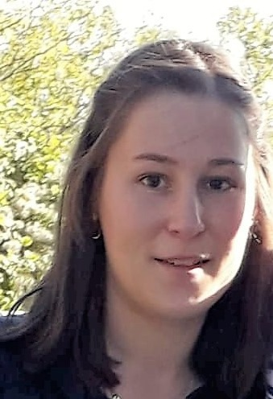{fig-alt="Bérengère Bastogne"}

::: body
::: name
Bérengère Bastogne
:::
::: role
Doctorante (2021–)
:::
::: thesis
Le rôle de la variation intraspécifique dans la modulation des effets des changements environnementaux d'origine anthropique sur les systèmes écologiques (champignons mycorhiziens)
:::
:::
:::

::: card-ns
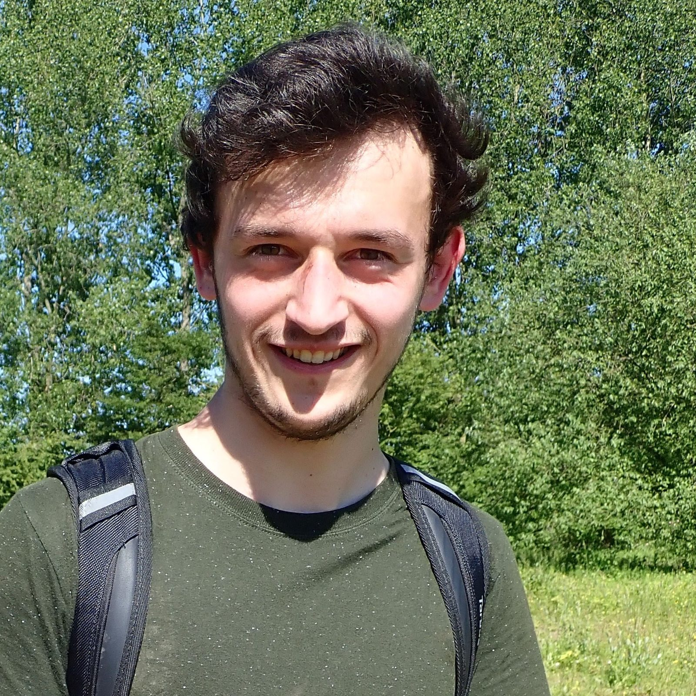{fig-alt="Victor Brans"}

::: body
::: name
Victor Brans
:::
::: role
Doctorant (2022–)
:::
::: thesis
Impacts et interactions de multiples facteurs de changement environnemental dans la nature : une analyse de viabilité de métapopulation de *Boloria eunomia* en Ardenne belge
:::
:::
:::

::: card-ns
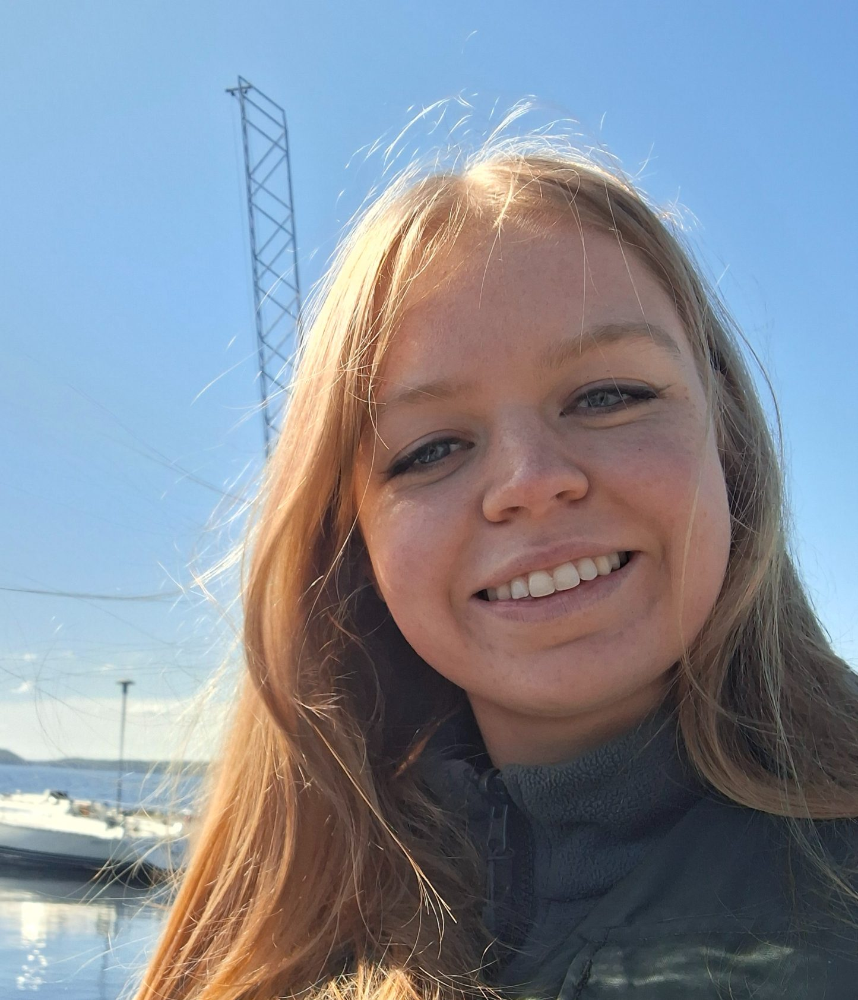{fig-alt="Michaëlla Dacek"}

::: body
::: name
Michaëlla Dacek
:::
::: role
Doctorante (2025–)
:::
::: thesis
Dévoiler les processus à l'origine de la dispersion, sa variation intraspécifique et sa modulation environnementale chez un cilié
:::
:::
:::
:::

## Anciens mentorés

::: cards
::: card-ns
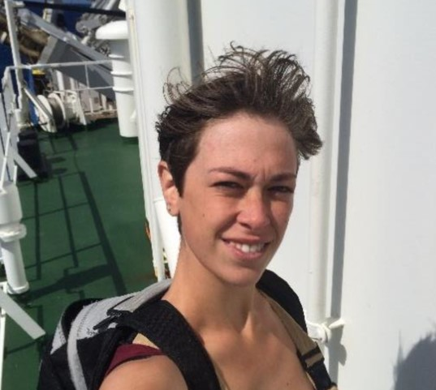{fig-alt="Tessa de Bruin"}

::: body
::: name
Tessa de Bruin
:::
::: role
Doctorante (2018–2026)
:::
::: thesis
Le rôle de la variation intraspécifique dans la modulation des effets des changements environnementaux d'origine anthropique sur les systèmes écologiques (protistes ciliés)
:::
:::
:::

::: card-ns
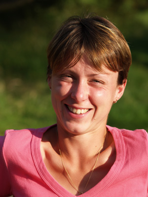{fig-alt="Julie Choutt"}

::: body
::: name
Dr. Julie Choutt
:::
::: role
Doctorante (2007–2011)
:::
::: thesis
Le papillon et la guêpe : relation hôte-parasitoïde entre *Boloria eunomia* et *Cotesia eunomiae*
:::
:::
:::

::: card-ns
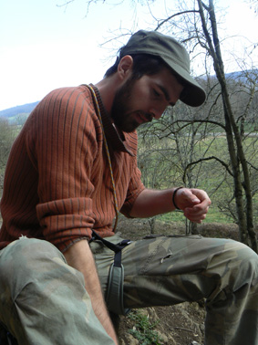{fig-alt="Quentin Dubois"}

::: body
::: name
Dr. Quentin Dubois
:::
::: role
Doctorant (2012–2018)
:::
::: thesis
La conservation du Nacré de la canneberge *Boloria aquilonaris* à travers l'espace et dans le temps : étude d'un papillon boréo-montagnard, de sa distribution à sa démographie
:::
::: now
Maintenant chef de projet @ Biotope Environnement (Belgique)
:::
:::
:::

::: card-ns
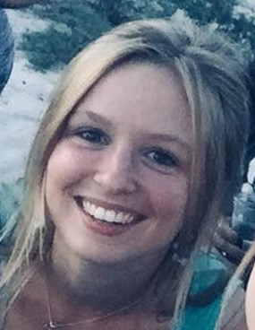{fig-alt="Marie-Charlotte Gielen"}

::: body
::: name
Dr. Marie-Charlotte Gielen
:::
::: role
Doctorante (2018–2025)
:::
::: thesis
Perfectionner les relevés de traces d'animaux pour soutenir la conservation de la grande faune et sa coexistence avec l'Homme dans le Kalahari
:::
:::
:::

::: card-ns
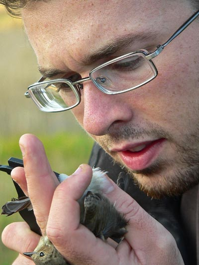{fig-alt="Staffan Jacob"}

::: body
::: name
Dr. Staffan Jacob
:::
::: role
Postdoc (2016–2018)
:::
::: thesis
Rôle de la dispersion non aléatoire dans l'hétérogénéité spatiale des phénotypes et la réponse des espèces aux changements environnementaux
:::
::: now
Maintenant chercheuse permanente @ CNRS Moulis (France)
:::
:::
:::

::: card-ns
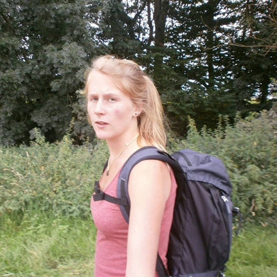{fig-alt="Estelle Laurent"}

::: body
::: name
Estelle Laurent
:::
::: role
Doctorante (2015–2022)
:::
::: thesis
Hétérogénéité de la dispersion : causes et conséquences chez un organisme cilié unicellulaire en microcosmes
:::
:::
:::

::: card-ns
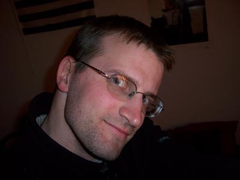{fig-alt="Christophe Lebigre"}

::: body
::: name
Dr. Christophe Lebigre
:::
::: role
Postdoc (2011–2016)
:::
::: thesis
Vieillissement des sous-populations et successions écologiques : une nouvelle perspective sur la génétique spatiale ?
:::
::: now
Maintenant chercheur permanent @ IFREMER (France)
:::
:::
:::

::: card-ns
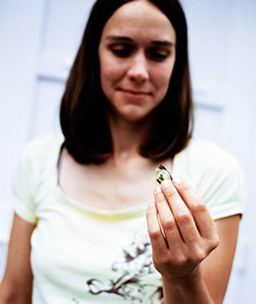{fig-alt="Delphine Legrand"}

::: body
::: name
Dr. Delphine Legrand
:::
::: role
Postdoc (2014–2015)
:::
::: thesis
Comment les organismes s'adaptent-ils aux changements des conditions environnementales : évolution expérimentale et approche génomique
:::
::: now
Maintenant chercheuse permanente @ CNRS Moulis (France)
:::
:::
:::

::: card-ns
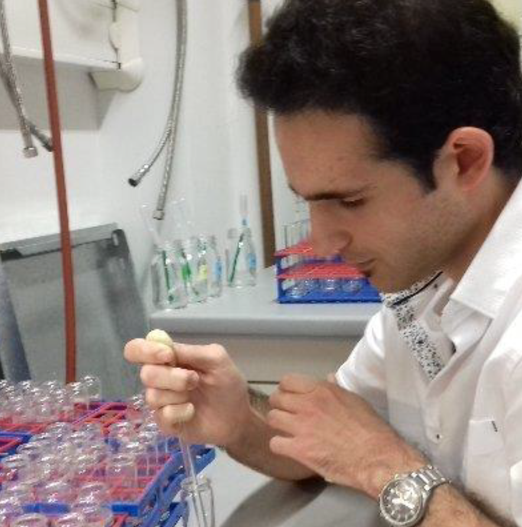{fig-alt="Florent Manzi"}

::: body
::: name
Dr. Florent Manzi
:::
::: role
Postdoc (2022–2024)
:::
::: thesis
Choix d'habitat : évolution et conséquences éco-évolutives
:::
:::
:::

::: card-ns
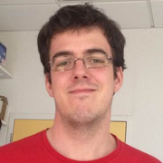{fig-alt="Thibaut Morel Journel"}

::: body
::: name
Dr. Thibaut Morel Journel
:::
::: role
Postdoc (2016–2018)
:::
::: thesis
Le rôle de la topologie du paysage dans la dynamique de métapopulation dans le contexte des changements environnementaux : des approches *in silico* aux approches *in vivo*
:::
::: now
Maintenant [professeur associé à Sorbonne Paris Nord (France)](https://thibaut-morel-journel.fulltxt.net/)
:::
:::
:::

::: card-ns
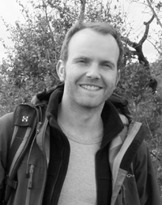{fig-alt="Frank Pennekamp"}

::: body
::: name
Dr. Frank Pennekamp
:::
::: role
Doctorant (2009–2014)
:::
::: thesis
Nager avec des ciliés — écologie de la dispersion et du mouvement de *T. thermophila*
:::
::: now
Maintenant [chef de groupe indépendant @ Université de Zurich (Suisse)](https://www.frank-pennekamp.info/)
:::
:::
:::

::: card-ns
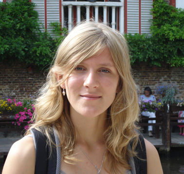{fig-alt="Viktoriia Radchuk"}

::: body
::: name
Dr. Viktoriia Radchuk
:::
::: role
Doctorante (2008–2012) · Postdoc (2012–2013)
:::
::: thesis
Traitement de la complexité biologique dans l'analyse de viabilité des populations : leçons de deux espèces de papillons menacées d'extinction
:::
::: now
Maintenant [chercheuse senior @ Leibniz Institute for Zoo and Wildlife Research (Allemagne)](https://www.viktoriiaradchuk.com/)
:::
:::
:::

::: card-ns
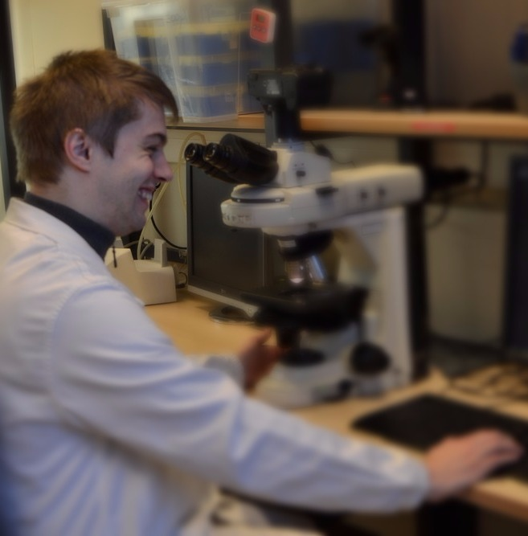{fig-alt="Nils Svendsen"}

::: body
::: name
Dr. Nils Svendsen
:::
::: role
Doctorant (2016–2024)
:::
::: thesis
Relations entre les traits fonctionnels dans les microcosmes expérimentaux du protiste *Tetrahymena thermophila*
:::
:::
:::

::: card-ns
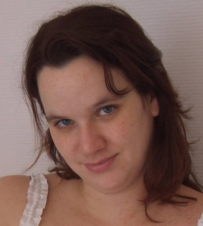{fig-alt="Virginie Thuillier"}

::: body
::: name
Virginie Thuillier
:::
::: role
Doctorante (2011–2017)
:::
::: thesis
Plasticité phénotypique et évolution des traits d'histoire de vie chez *Tetrahymena thermophila* en microcosmes
:::
:::
:::

::: card-ns
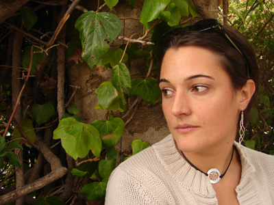{fig-alt="Camille Turlure"}

::: body
::: name
Dr. Camille Turlure
:::
::: role
Doctorante (2007–2009) · Postdoc (2011–2015)
:::
::: thesis
L'habitat du point de vue du papillon : comment les papillons spécialistes se calent sur les ressources écologiques
:::
::: now
Maintenant Center of Excellence Manager — Medical Communication CoE @ Akkodis (Belgique)
:::
:::
:::

::: card-ns
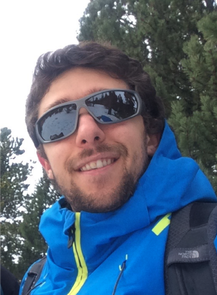{fig-alt="Allan Raffard"}

::: body
::: name
Dr. Allan Raffard
:::
::: role
Postdoc
:::
::: thesis
Variabilité intraspécifique, syndromes de dispersion et fonctionnement des méta-écosystèmes
:::
::: now
Maintenant [chercheur @ INRAE Thonon-les-Bains (France)](https://allanraffard.wordpress.com/)
:::
:::
:::
:::

## Où sont mes anciens mentorés aujourd'hui ?


