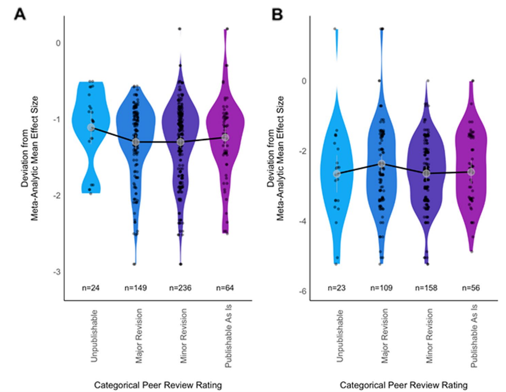

<!-- GENERATED FILE — do not edit.
     Source: ../publications.qmd + ../data/translations.fr.json
     Regenerate with: python tools/build_french.py -->
---
title: "Publications"
pagetitle: "Publications | Nicolas Schtickzelle, Professeur d'Ecologie"
description: "Publications phares et liste complète des publications de Nicolas Schtickzelle."
---

## Actualité des publications

::: theme
::: {}
### Nouvel article dans [BMC Biology](https://bmcbiol.biomedcentral.com/articles/10.1186/s12915-024-02101-x)

**Same data, different analysts: variation in effect sizes due to analytical decisions in ecology and evolutionary biology**

Un vaste projet collaboratif montrant à quel point les conclusions d'une étude écologique peuvent dépendre des choix analytiques de la personne qui analyse les données.
:::

{fig-alt="Cover figure of the BMC Biology paper"}
:::

## Liste complète des publications — articles à comité de lecture



## Liste complète des publications — chapitres de livres à comité de lecture



::: note-box
**Tirés à part.** Si vous n'avez pas accès à l'un de ces articles, [demandez-moi un tiré à part](mailto:nicolas.schtickzelle@uclouvain.be?subject=Demande%20de%20tir%C3%A9%20%C3%A0%20part) — c'est avec plaisir que je vous l'enverrai.

**A propos de cette liste.** Sur le site Wix, ces deux listes étaient produites par l'application tierce *Table Master*, qui conserve ses données sur ses propres serveurs plutôt que dans la page ; elles n'ont donc pas pu être copiées. La liste ci-dessous a été reconstruite à partir d'[OpenAlex](https://openalex.org) et couvre les années les plus récentes. Elle se trouve dans `data/publications.csv`, un simple fichier texte éditable dans Excel ou dans n'importe quel éditeur.
:::

::: {style="text-align:center"}
[Liste complète sur Google Scholar](https://scholar.google.be/citations?user=LH4kk5YAAAAJ&hl=en){.btn .btn-primary} [Scopus](https://www.scopus.com/authid/detail.uri?authorId=6603405906){.btn .btn-outline-secondary} [ResearchGate](https://www.researchgate.net/profile/Nicolas_Schtickzelle){.btn .btn-outline-secondary} [Web of Science](https://www.webofscience.com/wos/author/record/B-5916-2014){.btn .btn-outline-secondary}
:::
