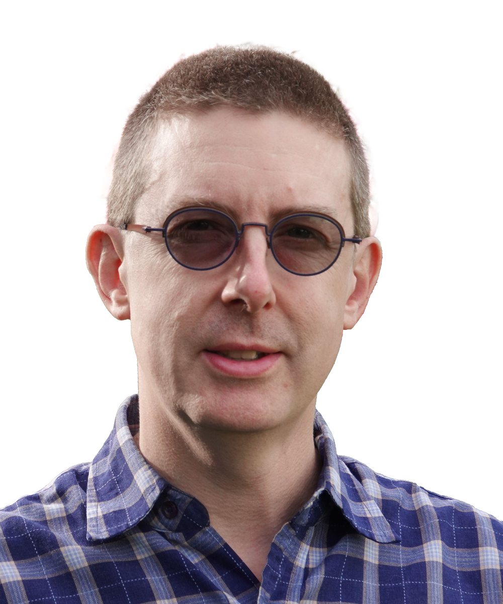

<!-- GENERATED FILE — do not edit.
     Source: ../short-bio.qmd + ../data/translations.fr.json
     Regenerate with: python tools/build_french.py -->
---
title: "Bio en bref"
pagetitle: "Bio en bref"
description: "Biographie succincte et étapes de carrière de Nicolas Schtickzelle, professeur d'écologie quantitative et de biologie de la conservation à l'UCLouvain."
---

::: intro
{fig-alt="Portrait of Nicolas Schtickzelle"}

::: {}
Je suis biologiste, intéressé par la compréhension du fonctionnement de la nature, et passionné par la découverte des paysages naturels et des organismes vivants à travers le monde. En tant que professeur d'écologie quantitative et de biologie de la conservation à l'UCLouvain, j'étudie comment les organismes se déplacent, se dispersent et persistent dans des paysages fragmentés et en mutation, et ce que cela implique pour leur viabilité à long terme.

Ma carrière s'est construite à l'UCLouvain, avec des séjours formateurs à l'étranger. Après un master en biologie (1997) et un diplôme d'études approfondies (1999), dont le mémoire en biométrie a reçu le prix Quetelet, j'ai réalisé mon doctorat (2003) avec Michel Baguette et Eric Le Boulengé sur la dynamique et la viabilité des métapopulations du nacré de la bistorte, incluant un séjour Marie Curie au UFZ de Leipzig. Comme chercheur postdoctoral F.R.S.-FNRS, j'ai travaillé avec Jean Clobert à Paris et Thomas Quinn à Seattle, ce qui m'a amené à appliquer la dynamique des métapopulations et la dispersion à d'autres organismes, comme le saumon et les protistes en microcosmes. Je suis ensuite devenu chercheur qualifié (2007) puis maître de recherches (2018) du F.R.S.-FNRS, tout en enseignant à l'UCLouvain, d'abord comme chargé de cours à temps partiel puis comme professeur à temps partiel. En 2024, j'ai quitté le F.R.S.-FNRS pour devenir professeur à temps plein à l'UCLouvain.

Au fil des années, j'ai construit le groupe Quantitative Conservation Biology autour de deux systèmes complémentaires : des études de terrain à long terme sur des papillons menacés, initiées par Michel Baguette en 1992, et des expériences en microcosmes de *Tetrahymena*, où les mécanismes écologiques peuvent être testés rigoureusement. J'investis délibérément dans le développement de méthodes, comme l'analyse d'images et de vidéos, l'impression 3D et les plans d'échantillonnage, et je les mets à la disposition de la communauté.

Je dirige une petite équipe où la formation des jeunes scientifiques passe en premier, et sept anciens mentorés occupent aujourd'hui un poste académique permanent. J'aime enseigner et partager les enjeux de la crise de la biodiversité avec les étudiants, le grand public et les décideurs. Je contribue aussi à la gestion de mon université, actuellement comme président de l'École de biologie et du Conseil de l'Earth and Life Institute.
:::
:::

## Distinctions et services à la communauté

- Membre des Académies royales des sciences et des arts de Belgique, Collège des Alumni (depuis 2008)
- Éditeur associé de *Frontiers in Ecology and Evolution* (depuis 2022) et de *Psyche* (depuis 2012) ; recommender pour *Peer Community In Ecology* (depuis 2023)
- Expert et membre de jurys pour des organismes de financement et des institutions de 10 pays et de l'Union européenne (plus de 50 évaluations)
- Membre des comités du service d'appui statistique de l'UCLouvain, SMCS (depuis 2010)

## Etapes de ma carrière

::: timeline
::: item
::: yr
2024 – aujourd'hui
:::
::: what
Professeur à temps plein @ UCLouvain, et Maître de recherches honoraire F.R.S.-FNRS
:::
:::

::: item
::: yr
2022 – aujourd'hui
:::
::: what
Président de l'Ecole de biologie @ UCLouvain
:::
:::

::: item
::: yr
2021 – aujourd'hui
:::
::: what
Président du Conseil de l'Earth and Life Institute @ UCLouvain
:::
:::

::: item
::: yr
2021 – 2024
:::
::: what
Responsable du pôle Ecologie et Biodiversité de l'Earth and Life Institute @ UCLouvain
:::
:::

::: item
::: yr
2018 – 2024
:::
::: what
Maître de recherches F.R.S.-FNRS @ UCLouvain
:::
:::

::: item
::: yr
2017 – 2024
:::
::: what
Président de l'APERFU, l'association des chercheurs permanents F.R.S.-FNRS @ UCLouvain
:::
:::

::: item
::: yr
2015 – 2024
:::
::: what
Professeur à temps partiel @ UCLouvain
:::
:::

::: item
::: yr
2010 – 2017
:::
::: what
Président du Centre de recherche sur la biodiversité @ UCLouvain
:::
:::

::: item
::: yr
2008 – 2009
:::
::: what
Secrétaire académique du Département de biologie @ UCLouvain
:::
:::

::: item
::: yr
2007 – 2018
:::
::: what
Chercheur qualifié F.R.S.-FNRS @ UCLouvain
:::
:::

::: item
::: yr
2007 – 2015
:::
::: what
Chargé de cours à temps partiel @ UCLouvain
:::
:::

::: item
::: yr
2005
:::
::: what
Séjour postdoctoral (3 mois) chez le Prof. Thomas P. Quinn, University of Washington, Seattle, Etats-Unis
:::
:::

::: item
::: yr
2004
:::
::: what
Séjour postdoctoral (6 mois) chez le Dr Jean Clobert, Université Paris 6, France
:::
:::

::: item
::: yr
2003 – 2007
:::
::: what
Chercheur postdoctoral F.R.S.-FNRS avec le Prof. Michel Baguette @ UCLouvain
:::
:::

::: item
::: yr
2003
:::
::: what
Doctorat en biologie, UCLouvain, Belgique — promoteurs Prof. Michel Baguette & Prof. Eric Le Boulengé
:::
:::

::: item
::: yr
2001
:::
::: what
Chercheur invité (4 mois, bourse Marie Curie) @ UFZ Leipzig, Allemagne
:::
:::

::: item
::: yr
1999
:::
::: what
Diplôme d'études approfondies en biologie, UCLouvain, Belgique
:::
:::

::: item
::: yr
1997
:::
::: what
Licence en biologie, UCLouvain, Belgique
:::
:::
:::
