<!-- GENERATED FILE — do not edit.
     Source: ../teaching.qmd + ../data/translations.fr.json
     Regenerate with: python tools/build_french.py -->
---
title: "Enseignement"
pagetitle: "Enseignement"
description: "Ma philosophie d'enseignement et la description des cours que je donne à l'UCLouvain."
---

Outre le mentorat individuel, j'aime aussi beaucoup partager mes connaissances par le biais de l'enseignement.

Je nourris mes exposés en me basant sur les résultats de la recherche mais je privilégie également l'apprentissage interactif et l'esprit critique, un point que je considère plus essentiel que jamais dans un monde où l'accès à l'information n'est plus un défi mais bien sa synthèse et son analyse critique.

J'enseigne actuellement des cours aux étudiants de bachelier et de master en Biologie @ UCLouvain portant sur les statistiques pour la biologie, la conservation de la biodiversité et l'écologie de terrain. Je suis fier que mes cours reçoivent des évaluations très positives des étudiants.

## Cours

::: course
### Principes de statistiques et analyse des données biologiques — LBIO1283

::: meta
Bachelier en Biologie, 3e année · 4 ECTS
:::

Le cours forme l'étudiant à comprendre et utiliser correctement et de manière critique les principales méthodes d'analyse statistique de données biologiques et environnementales. Il perçoit la relation entre la conception expérimentale et le modèle d'analyse ainsi que la nécessité de planifier les expériences, et se familiarise avec l'analyse de données assistée par ordinateur.

A l'issue de ce cours, l'étudiant devra maîtriser les méthodes de base pour l'analyse de données biologiques, être capable de choisir le modèle d'analyse et la méthode adaptés à la conception d'expériences factorielles simples, afin d'analyser et d'interpréter correctement les résultats de ces expériences. Il devrait pouvoir ensuite progresser par lui-même et suivre avec profit des cours avancés sur la conception expérimentale et l'analyse des données.

::: gallery
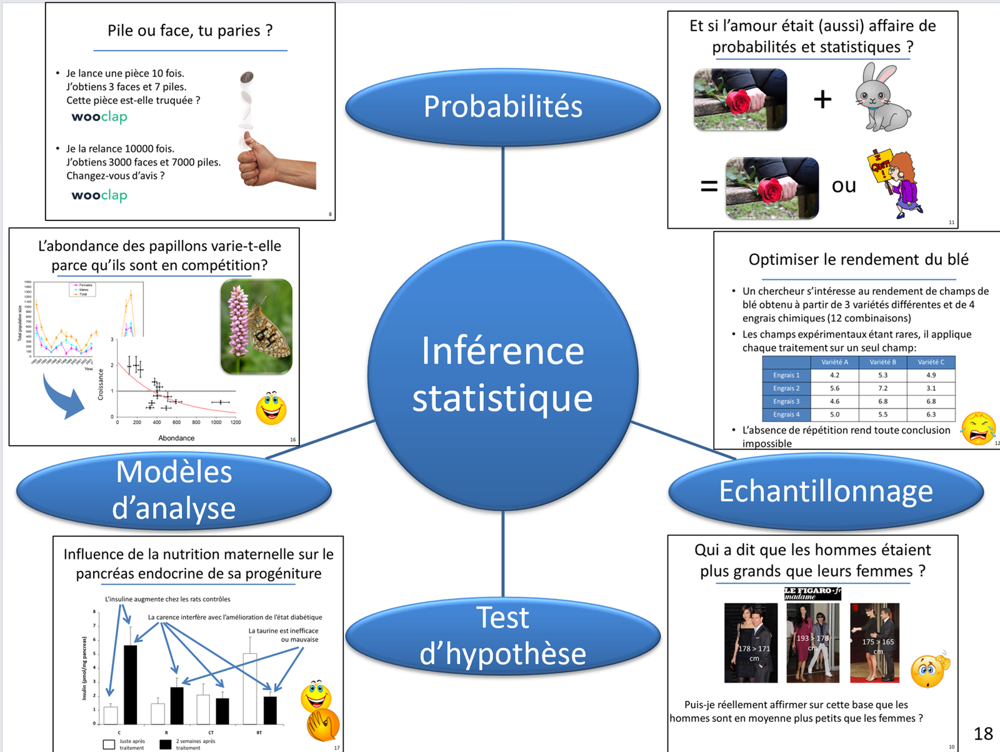{fig-alt="LBIO1283 course slide"}
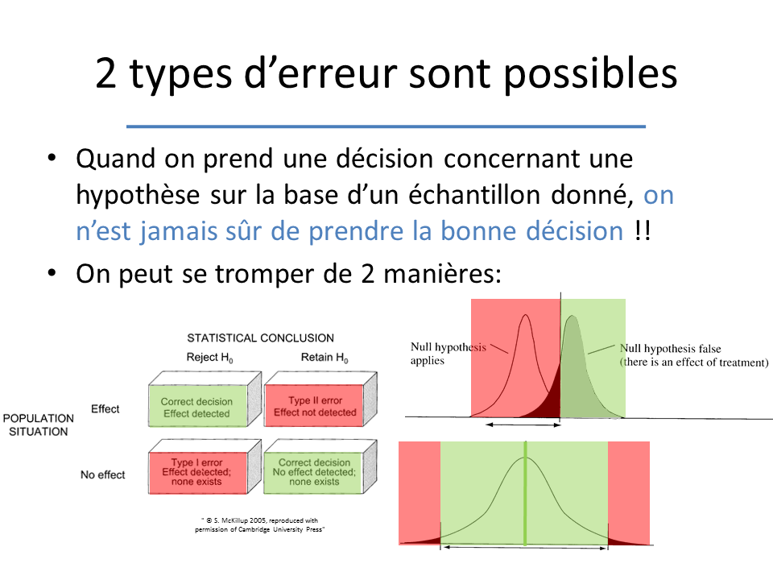{fig-alt="LBIO1283 course slide"}
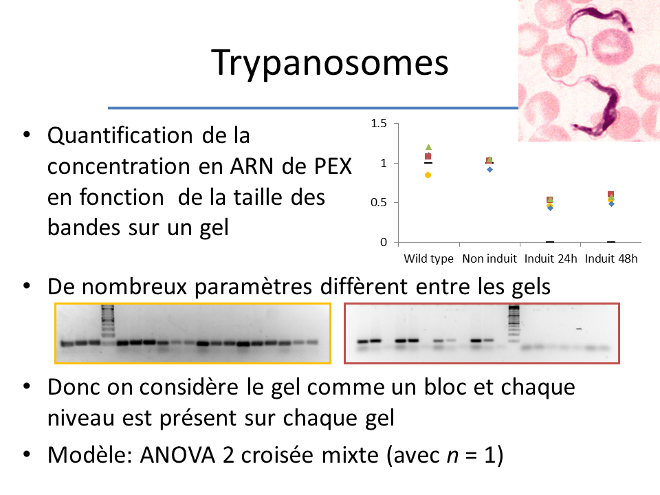{fig-alt="LBIO1283 course slide"}
:::
:::

::: course
### Conservation de la biodiversité — LBOE2120

::: meta
Master en Biologie, 1re année · 4 ECTS
:::

Le cours met l'accent sur une approche multidisciplinaire de la biologie de la conservation intégrant écologie, biogéographie et génétique, pour aboutir à une approche de modélisation. Ensuite, le cours couvre l'aspect appliqué de cette discipline, en intégrant une pensée politique et socio-économique.

Le cours commence par définir les niveaux de biodiversité, ses variations spatio-temporelles et son état actuel. La particularité de la crise d'extinction actuelle est contrastée avec les extinctions du passé. Ensuite, les différentes menaces à la biodiversité, causées par les impacts humains sur l'environnement, sont détaillées, avec les risques associés pour la biodiversité et l'humanité. Suit un aperçu des approches de conservation et de gestion des territoires et des espèces menacés.

Une visite dans la forêt expérimentale de l'UCLouvain (Bois de Lauzelle) fournit des illustrations réelles des risques pour la biodiversité et des approches de conservation et/ou de restauration pour les limiter.

::: gallery
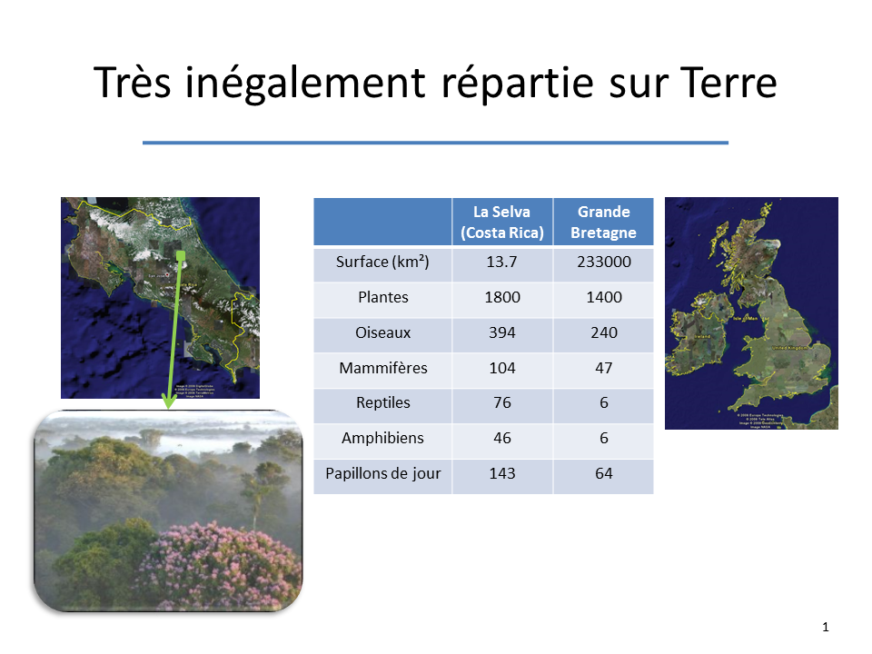{fig-alt="LBOE2120 course slide"}
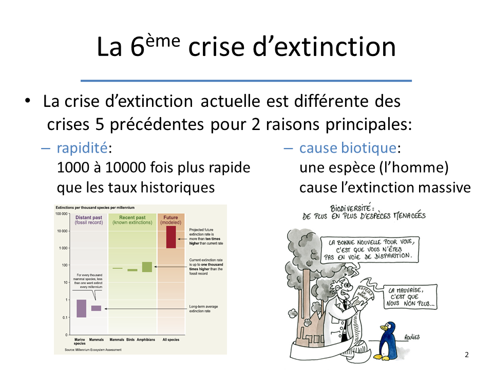{fig-alt="LBOE2120 course slide"}
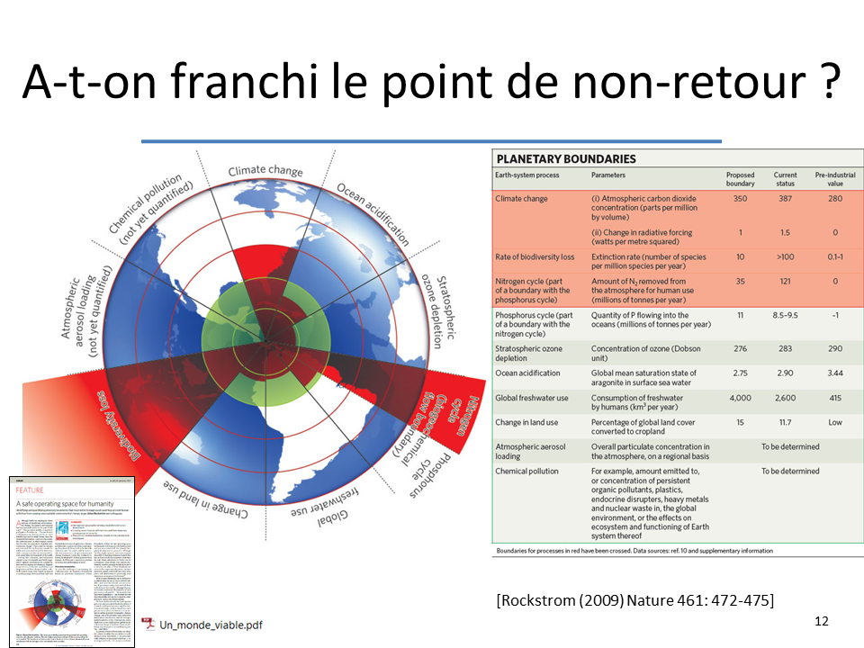{fig-alt="LBOE2120 course slide"}
:::
:::

::: course
### Démarche scientifique en biologie — LBIO1116

::: meta
Bachelier en Biologie, 1re année · 4 ECTS (partim)
:::

Le cours développe plusieurs aspects de la démarche scientifique en biologie : les méthodes déductives et inductives, l'acquisition et la vérification de données expérimentales et d'observation, la recherche et l'analyse d'informations scientifiques. L'accent est mis sur le développement de la pensée critique.

Dans ce cours donné par deux enseignants, je me concentre plus particulièrement sur les données scientifiques : à travers des activités interactives, les étudiants explorent les différentes sources de variation des données, apprennent à bien développer des contrôles de validation spécifiques, à visualiser leurs données et à réaliser des statistiques descriptives. Je supervise également un projet pratique où les étudiants apprennent à développer et à appliquer un protocole expérimental.

::: gallery
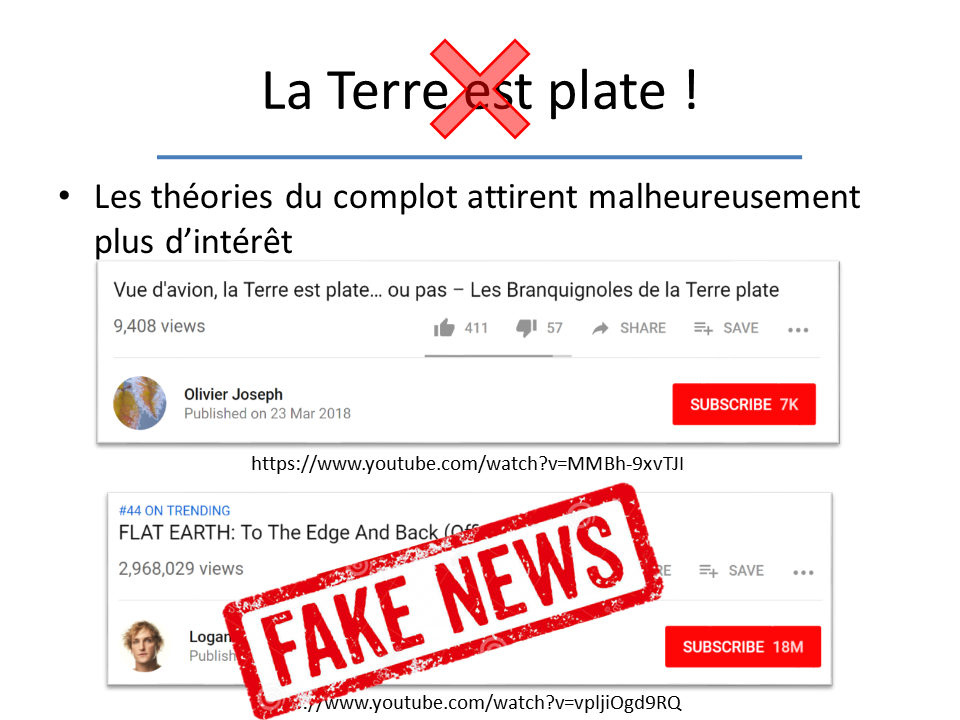{fig-alt="LBIO1116 course slide"}
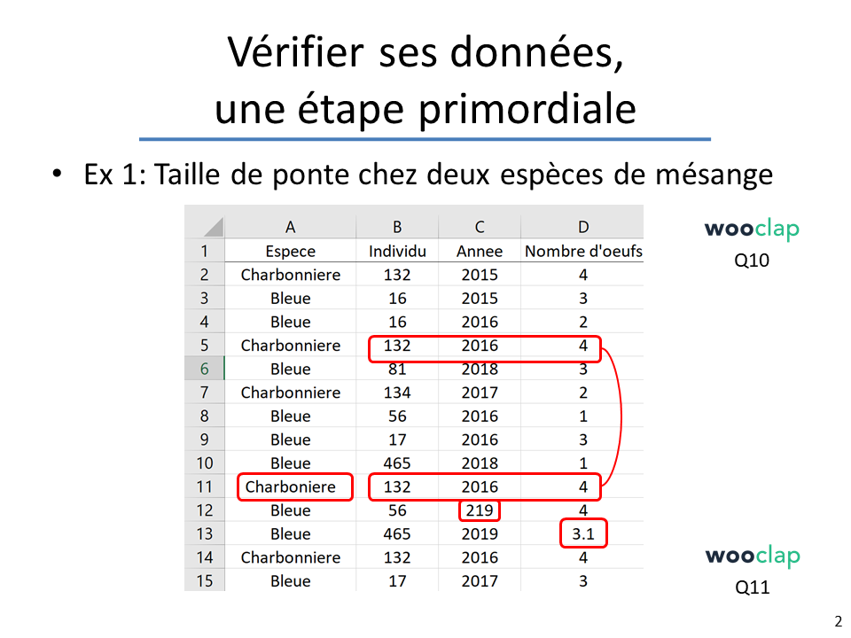{fig-alt="LBIO1116 course slide"}
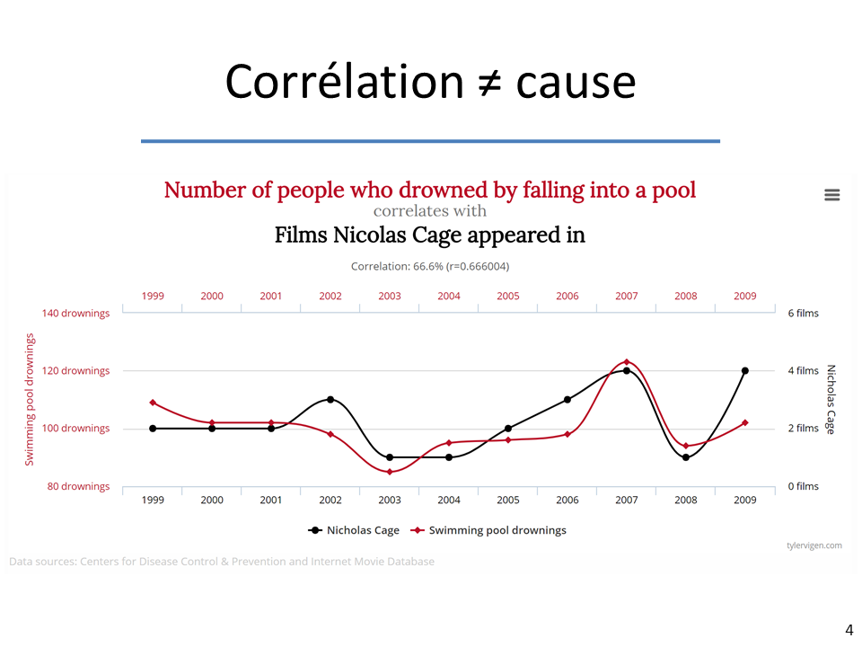{fig-alt="LBIO1116 course slide"}
:::
:::

::: course
### Analyse de données et modélisation des systèmes biologiques — LBOE2112

::: meta
Master en Biologie, 1re année · 5 ECTS (partim)
:::

J'enseigne le module « Analyse des données multivariées » de ce cours. L'accent est mis sur la compréhension et l'application critique des statistiques multivariées comme outils de recherche en écologie. Je me concentre sur l'importance de la visualisation des données, de leur vérification et de la détermination de la meilleure approche d'analyse pour chaque étude de cas spécifique. J'insiste sur les risques associés à la réalisation d'analyses statistiques à l'aide de packages R sans comprendre les paramètres d'entrée nécessaires et vérifier leurs valeurs par défaut.

::: gallery
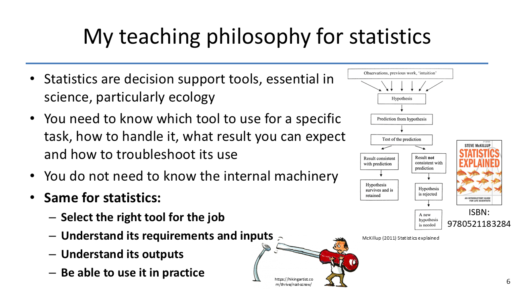{fig-alt="LBOE2112 course slide"}
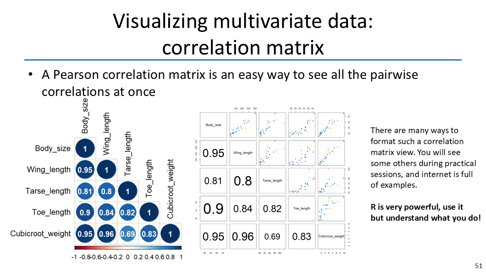{fig-alt="LBOE2112 course slide"}
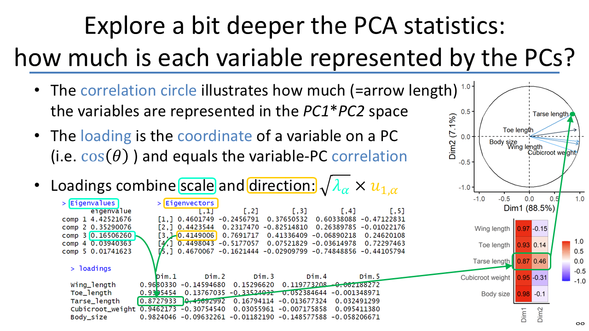{fig-alt="LBOE2112 course slide"}
:::
:::
