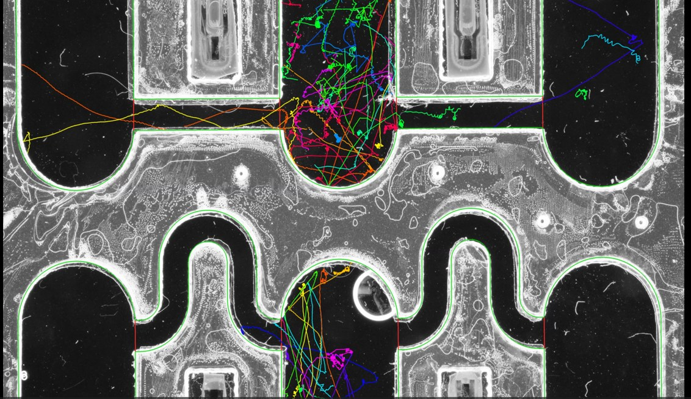
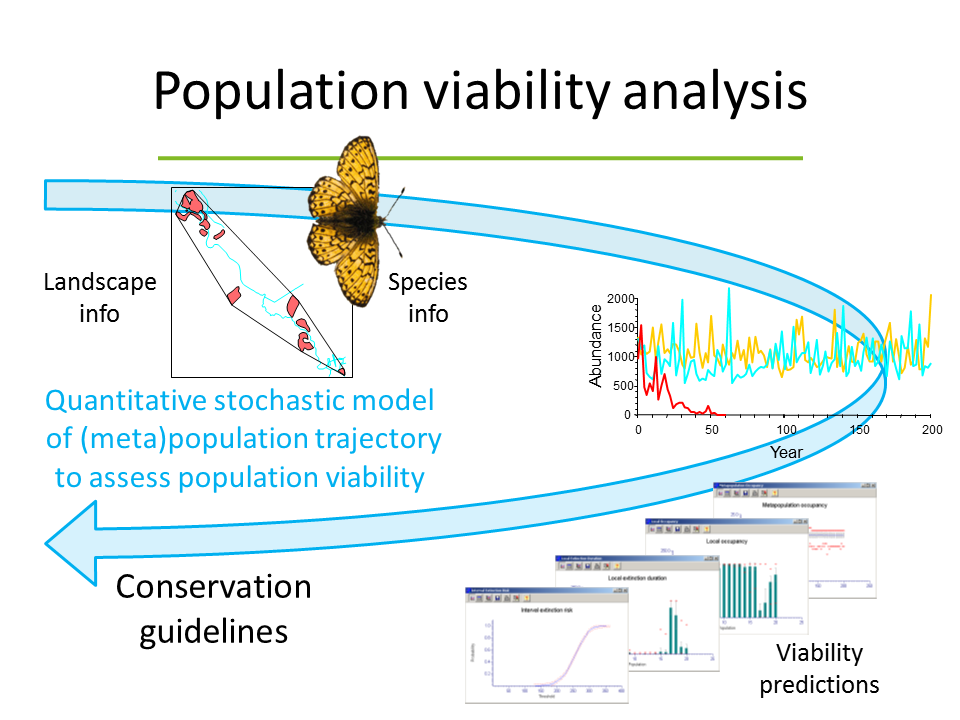
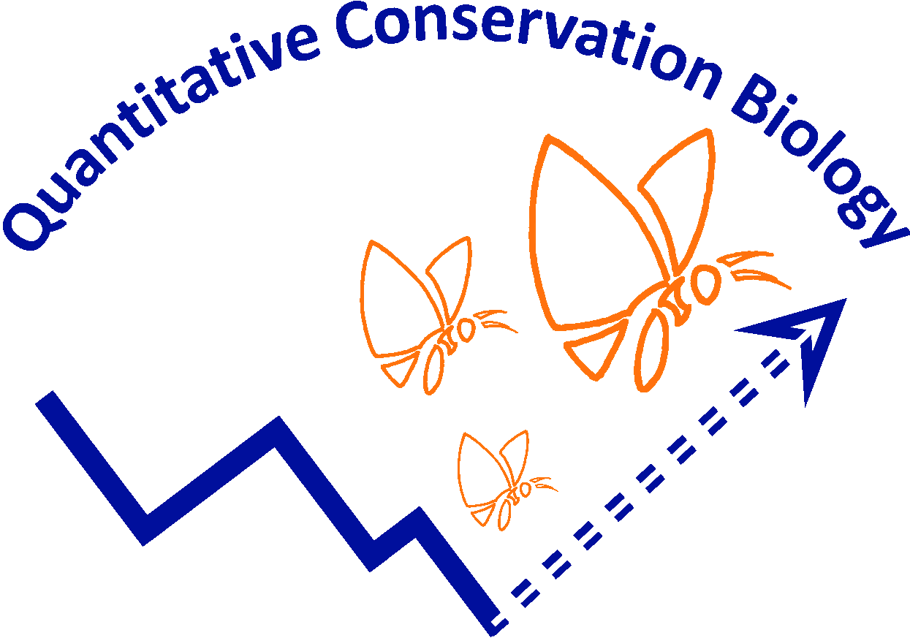

::: {.hero .hero-photo style="background-image: url('assets/img/hero-boloria.jpg')"}
# Researcher and Professor in Quantitative Ecology and Conservation Biology

::: tagline
UCLouvain (Louvain-la-Neuve, Belgium)\
Earth and Life Institute · Ecology and Biodiversity
:::

::: hero-logos
[{fig-alt="UCLouvain"}](https://uclouvain.be/en/index.html)
[{fig-alt="Earth and Life Institute"}](https://uclouvain.be/en/research-institutes/eli)
[{fig-alt="ELI Ecology and Biodiversity"}](https://uclouvain.be/en/research-institutes/eli/ecology-and-biodiversity)
:::
:::

::: home-lead
{fig-alt="Portrait of Nicolas Schtickzelle"}

::: {}
**How do populations react to global environmental change, and what does it mean
for their long-term viability?** This question drives my research in quantitative
ecology and conservation biology.

[More about me: short bio and career →](short-bio.qmd){.home-more}
:::
:::

## Research

::: home-cards
::: home-card
{fig-alt="Boloria eunomia butterflies mating"}

### Metapopulation dynamics

::: card-systems
Butterflies · salmon
:::

How local demography and dispersal between populations combine to keep species
persisting in fragmented landscapes, building on three decades of monitoring of the
bog fritillary *Boloria eunomia* in Belgium.

::: key-papers
**Key papers**

- A long-term study reveals strong synchronizing weather effects on population dynamics of the butterfly *Boloria eunomia* — Brans, Baguette & Schtickzelle 2026, *Ecosphere* (in press)
- [Population dynamics and asynchrony at fine spatial scales: a case history of sockeye salmon population structure in Alaska](https://doi.org/10.1139/f2011-147) — Quinn, Rich, Gosse & Schtickzelle 2012, *Canadian Journal of Fisheries and Aquatic Sciences*
- [Metapopulation dynamics of the bog fritillary butterfly: experimental changes in habitat quality induced negative density-dependent dispersal](https://doi.org/10.1111/j.1600-0587.2010.06212.x) — Baguette, Clobert & Schtickzelle 2011, *Ecography*
:::
:::

::: home-card
{fig-alt="Movement tracks of Tetrahymena cells in a fragmented two-dimensional microcosm"}

### Dispersal and movement ecology

::: card-systems
Butterflies in the field · protists in microcosms
:::

The causes and consequences of dispersal: how individual movement and decisions drive
dispersal, and the role of intraspecific variability.

::: key-papers
**Key papers**

- [Tracking cell movement in two-dimensional, fragmented microcosms reveals dispersal syndromes and strategies in *Tetrahymena thermophila*](https://doi.org/10.1002/ece3.73092) — Manzi, Brans, Dacek, Jacob & Schtickzelle 2026, *Ecology and Evolution*
- [Habitat choice meets thermal specialization](https://doi.org/10.1073/pnas.1805574115) — Jacob et al. 2018, *PNAS*
- [Dispersal depression with habitat fragmentation in the bog fritillary butterfly](https://doi.org/10.1890/0012-9658%282006%2987%5B1057:ddwhfi%5D2.0.co;2) — Schtickzelle, Mennechez & Baguette 2006, *Ecology*
:::
:::

::: home-card
{fig-alt="Population viability analysis as a crystal ball"}

### Forecasting species viability

::: card-systems
Butterflies · amphibians · macaques
:::

Population viability analysis to forecast the persistence of species and populations
facing global change, and to guide their conservation.

::: key-papers
**Key papers**

- [Integrating Indigenous knowledge and modern statistical approaches to model wildlife density based on animal track counts](https://doi.org/10.1111/cobi.70397) — Gielen et al. 2026, *Conservation Biology*
- [Each life stage matters: assessing the response to climate change over the complete life cycle in butterflies](https://doi.org/10.1111/j.1365-2656.2012.02029.x) — Radchuk, Turlure & Schtickzelle 2013, *Journal of Animal Ecology*
- [Metapopulation viability analysis of the bog fritillary butterfly using RAMAS/GIS](https://doi.org/10.1111/j.0030-1299.2004.12825.x) — Schtickzelle & Baguette 2004, *Oikos*
:::
:::

::: home-card
{fig-alt="Tetrahymena thermophila movement trajectories from automatic video analysis"}

### Developing methods for ecology

::: card-systems
In the field and in the lab
:::

Developing and sharing methods: sampling designs and statistics, software for
automatic video analysis, and [3D printing of experimental
landscapes](https://doi.org/10.20944/preprints202003.0220.v1).

::: key-papers
**Key papers**

- [To replicate, or not to replicate – that is the question](https://doi.org/10.1111/ele.13134) — Kreyling et al. 2018, *Ecology Letters*
- [A simplified Mark Release Recapture protocol to improve the cost effectiveness of repeated population size quantification](https://doi.org/10.1111/2041-210x.12900) — Turlure, Pe’er, Baguette & Schtickzelle 2018, *Methods in Ecology and Evolution*
- [Bemovi, software for extracting behavior and morphology from videos](https://doi.org/10.1002/ece3.1529) — Pennekamp, Schtickzelle & Petchey 2015, *Ecology and Evolution*
:::
:::
:::

[All research interests →](research-interests.qmd){.home-more}

## The Quantitative Conservation Biology group

::: theme
::: {}
We are a small, collaborative team studying how populations cope with habitat fragmentation
and global change, through dispersal, metapopulation dynamics and population viability.
We combine field studies of butterflies, laboratory experiments with protists in microcosms
and quantitative modelling to understand these processes and help reverse biodiversity loss.
We also enjoy developing new methods and tools for ecology and evolution, and sharing
them with the community.

So far: 7 PhD theses completed and 4 ongoing, 8 postdocs and 50 MSc theses supervised;
7 former mentees now hold permanent academic positions.

[Meet the team and our alumni →](mentoring.qmd){.home-more}
:::

{fig-alt="Quantitative Conservation Biology group logo"}
:::

## Latest publications



[All publications and bibliometry →](publications.qmd){.home-more}

## Teaching

I teach BSc and MSc students in Biology at UCLouvain, in two areas:

- **Ecology:** *Biodiversity conservation* (LBOE2120) and the *Field course in
  integrated ecology* (LBOE2114).
- **Methods and statistics:** *Statistical principles and analysis of biological data*
  (LBIO1283), *Scientific approach in biology* (LBIO1116) and *Data analysis and
  modeling of biological systems* (LBOE2112).

[Course details →](teaching.qmd){.home-more}

## Contact

::: home-contact
**Email:** [nicolas.schtickzelle \[at\] uclouvain.be](#email)\
**Office:** Carnoy building, room c.157, Croix du Sud 4, Louvain-la-Neuve

[Address, map and directions →](contact.qmd){.home-more}
:::
