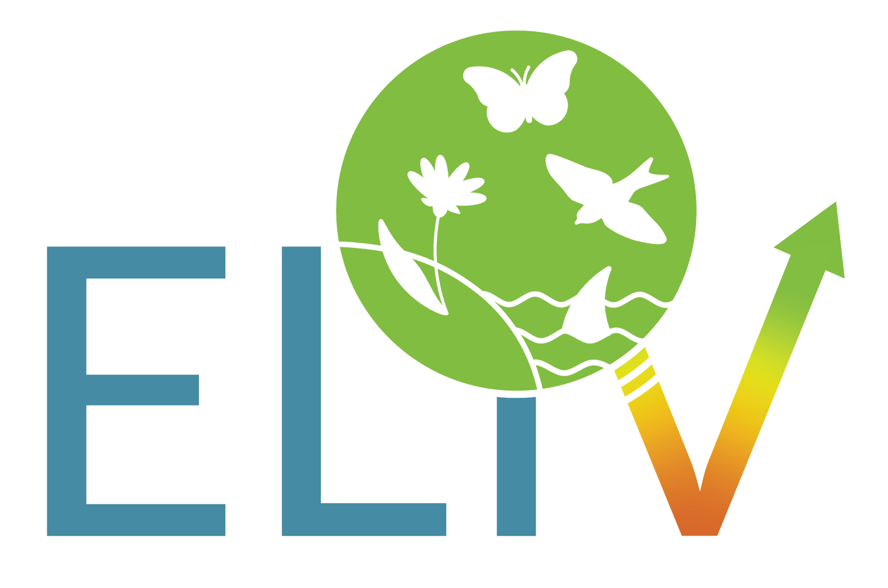
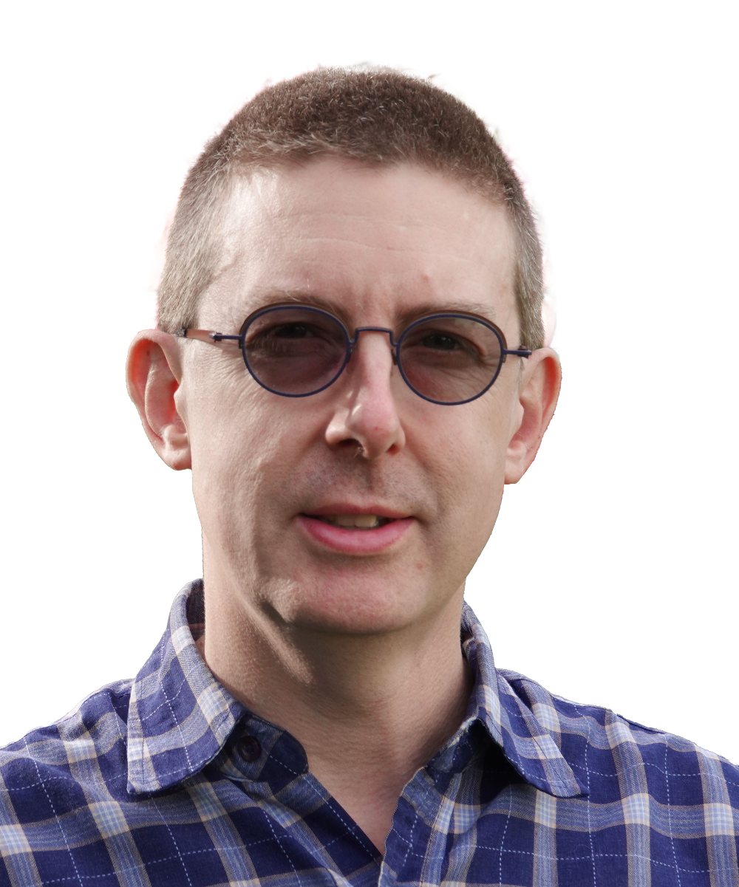

::: {.hero .hero-photo style="background-image: url('assets/img/hero-boloria.jpg')"}
# Researcher and Professor in Quantitative Ecology and Conservation Biology

::: tagline
UCLouvain (Louvain-la-Neuve, Belgium)\
Earth and Life Institute · Ecology and Biodiversity
:::

::: hero-logos
[{fig-alt="UCLouvain"}](https://uclouvain.be/en/index.html)
[{fig-alt="Earth and Life Institute"}](https://uclouvain.be/en/research-institutes/eli)
[{fig-alt="ELI Ecology and Biodiversity"}](https://uclouvain.be/en/research-institutes/eli/ecology-and-biodiversity)
:::
:::

::: home-lead
{fig-alt="Portrait of Nicolas Schtickzelle"}

::: {}
**How do populations react to global environmental change, and what does it mean
for their long-term viability?** This question drives my research in quantitative
ecology and conservation biology.

[More about me: short bio and career →](short-bio.qmd){.home-more}
:::
:::

## Research

::: home-cards
::: home-card
{fig-alt="Boloria eunomia butterflies mating"}

### Butterflies in the field

Long-term monitoring and capture–mark–recapture of the bog fritillary *Boloria
eunomia* in Belgium since 1992: metapopulation dynamics and movement.
:::

::: home-card
{fig-alt="Tetrahymena thermophila movement trajectories"}

### Protists in microcosms

Laboratory experiments with the ciliate *Tetrahymena thermophila* on how individual
movement and decisions drive dispersal, and on the role of intraspecific variability.
:::

::: home-card
{fig-alt="Population viability analysis as a crystal ball"}

### Quantitative modelling

Population viability analysis to forecast the persistence of species and populations
facing global change.
:::

::: home-card
{fig-alt="3D-printed artificial landscape for microcosm experiments"}

### Methods for ecology

Developing and sharing methods: sampling designs and statistics, software for
automatic video analysis, and [3D printing of experimental
landscapes](https://doi.org/10.20944/preprints202003.0220.v1).
:::
:::

[All research interests →](research-interests.qmd){.home-more}

## The Quantitative Conservation Biology group

::: theme
::: {}
We are a small, collaborative team studying how populations cope with habitat fragmentation
and global change, through dispersal, metapopulation dynamics and population viability.
We combine field studies of butterflies, laboratory experiments with protists in microcosms
and quantitative modelling to understand these processes and help reverse biodiversity loss.
We also enjoy developing new methods and tools for ecology and evolution, and sharing
them with the community.

So far: 7 PhD theses completed and 4 ongoing, 8 postdocs and 50 MSc theses supervised;
7 former mentees now hold permanent academic positions.

[Meet the team and our alumni →](mentoring.qmd){.home-more}
:::

{fig-alt="Quantitative Conservation Biology group logo"}
:::

## Latest publications



[All publications and bibliometry →](publications.qmd){.home-more}

## Teaching

I teach BSc and MSc students in Biology at UCLouvain, in two areas:

- **Ecology:** *Biodiversity conservation* (LBOE2120) and the *Field course in
  integrated ecology* (LBOE2114).
- **Methods and statistics:** *Statistical principles and analysis of biological data*
  (LBIO1283), *Scientific approach in biology* (LBIO1116) and *Data analysis and
  modeling of biological systems* (LBOE2112).

[Course details →](teaching.qmd){.home-more}

## Contact

::: home-contact
**Email:** [nicolas.schtickzelle \[at\] uclouvain.be](#email)\
**Office:** Carnoy building, room c.157, Croix du Sud 4, Louvain-la-Neuve

[Address, map and directions →](contact.qmd){.home-more}
:::
