

Mentoring has always had an important place in my life, from high school to
research group leader.

For my team, I aim to perform innovative and high-quality research in a mutually
supportive and attractive working environment, where students and collaborators
blossom into satisfied and recognized researchers.

As a PI, I am committed to invest my deepest energy into the supervision of young
researchers from my own team and visitors from my research network. An important
proportion of my former mentees were able to pursue a career in academia.

I am always welcoming motivated students and researchers; if you are interested,
don't hesitate to [get in touch](contact.qmd).

::: figures
::: figure-box
::: n
8
:::
::: lab
postdocs
:::
:::

::: figure-box
::: n
7
:::
::: lab
PhD theses completed
:::
:::

::: figure-box
::: n
4
:::
::: lab
on-going PhD theses
:::
:::

::: figure-box
::: n
50
:::
::: lab
MSc theses
:::
:::

::: figure-box
::: n
9
:::
::: lab
research internships
:::
:::
:::

## Current mentees

::: cards
::: card-ns
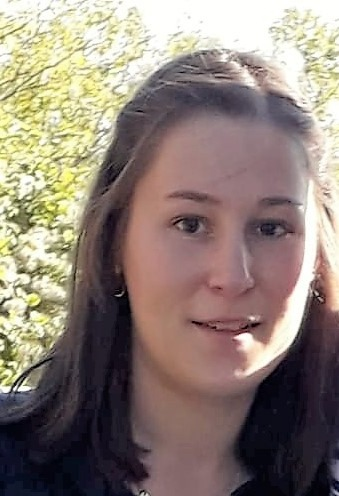{fig-alt="Bérengère Bastogne"}

::: body
::: name
Bérengère Bastogne
:::
::: role
PhD student (2021–)
:::
::: thesis
The role of intraspecific variation in modulating the effects of environmental
change drivers on ecological systems (mycorrhizal fungi)
:::
:::
:::

::: card-ns
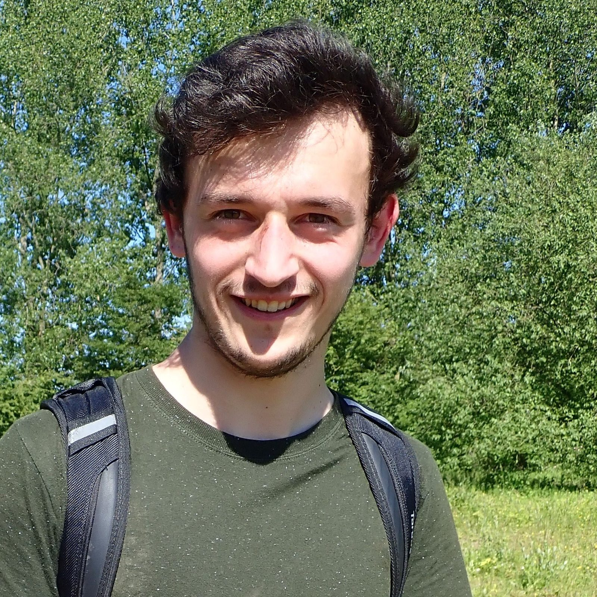{fig-alt="Victor Brans"}

::: body
::: name
Victor Brans
:::
::: role
PhD student (2022–)
:::
::: thesis
Impacts and interactions of multiple environmental change drivers in nature: a
metapopulation viability analysis of *Boloria eunomia* in Belgian Ardenne
:::
:::
:::

::: card-ns
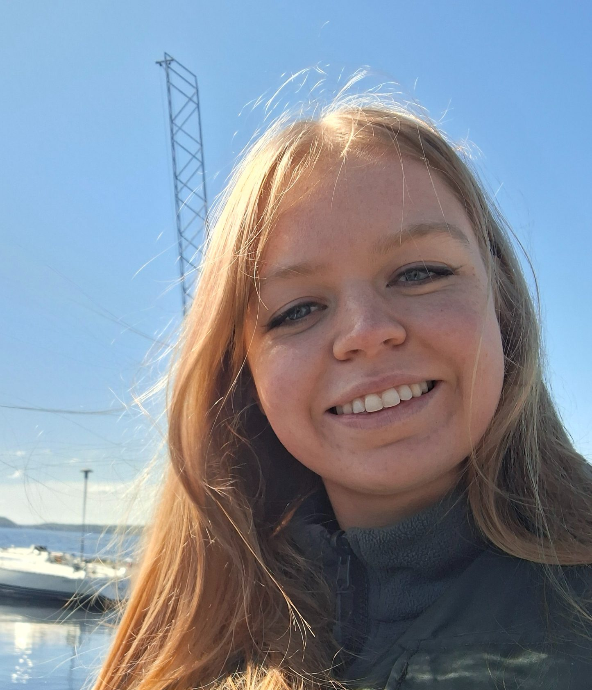{fig-alt="Michaëlla Dacek"}

::: body
::: name
Michaëlla Dacek
:::
::: role
PhD student (2025–)
:::
::: thesis
Unveiling the processes behind dispersal, its intraspecific variation and its
environmental modulation in a ciliate
:::
:::
:::

::: card-ns
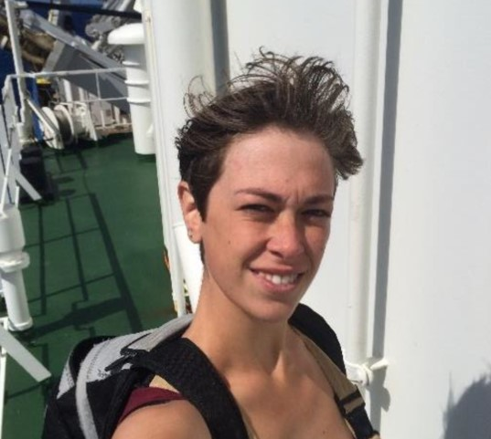{fig-alt="Tessa de Bruin"}

::: body
::: name
Tessa de Bruin
:::
::: role
PhD student (2018–)
:::
::: thesis
The role of intraspecific variation in modulating the effects of environmental
change drivers on ecological systems (ciliated protists)
:::
:::
:::
:::

## Former mentees

::: cards
::: card-ns
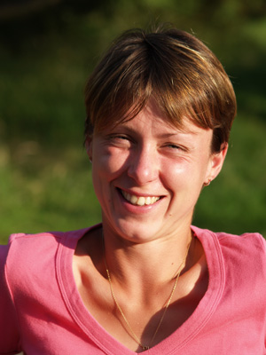{fig-alt="Julie Choutt"}

::: body
::: name
Dr. Julie Choutt
:::
::: role
PhD student (2007–2011)
:::
::: thesis
The butterfly and the wasp: host–parasitoid relationship between *Boloria eunomia*
and *Cotesia eunomiae*
:::
:::
:::

::: card-ns
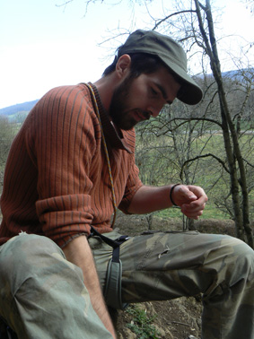{fig-alt="Quentin Dubois"}

::: body
::: name
Dr. Quentin Dubois
:::
::: role
PhD student (2012–2018)
:::
::: thesis
The conservation of the Cranberry Fritillary *Boloria aquilonaris* across space and
over time: study of a boreo-montane butterfly from distribution to demography
:::
::: now
Now project manager @ Biotope Environnement (Belgium)
:::
:::
:::

::: card-ns
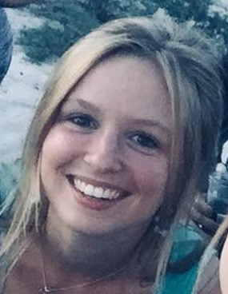{fig-alt="Marie-Charlotte Gielen"}

::: body
::: name
Dr. Marie-Charlotte Gielen
:::
::: role
PhD student (2018–2025)
:::
::: thesis
Refining track-based surveys to support wildlife conservation and human coexistence
in the Kalahari
:::
:::
:::

::: card-ns
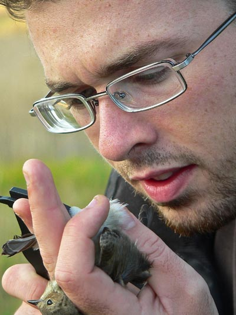{fig-alt="Staffan Jacob"}

::: body
::: name
Dr. Staffan Jacob
:::
::: role
Postdoc (2016–2018)
:::
::: thesis
Role of nonrandom dispersal in spatial heterogeneity of phenotypes and species
response to environmental change
:::
::: now
Now permanent researcher @ CNRS Moulis (France)
:::
:::
:::

::: card-ns
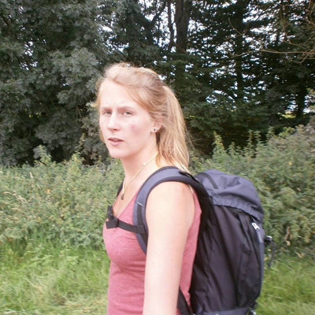{fig-alt="Estelle Laurent"}

::: body
::: name
Estelle Laurent
:::
::: role
PhD student (2015–2022)
:::
::: thesis
Dispersal heterogeneity: causes and consequences in a unicellular ciliate organism
in microcosms
:::
:::
:::

::: card-ns
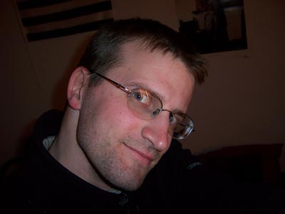{fig-alt="Christophe Lebigre"}

::: body
::: name
Dr. Christophe Lebigre
:::
::: role
Postdoc (2011–2016)
:::
::: thesis
Ageing subpopulations and ecological successions: a new perspective on spatial
genetics?
:::
::: now
Now permanent researcher @ IFREMER (France)
:::
:::
:::

::: card-ns
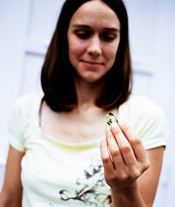{fig-alt="Delphine Legrand"}

::: body
::: name
Dr. Delphine Legrand
:::
::: role
Postdoc (2014–2015)
:::
::: thesis
How do organisms adapt to changes in environmental conditions: an experimental
evolution and genomic approach
:::
::: now
Now permanent researcher @ CNRS Moulis (France)
:::
:::
:::

::: card-ns
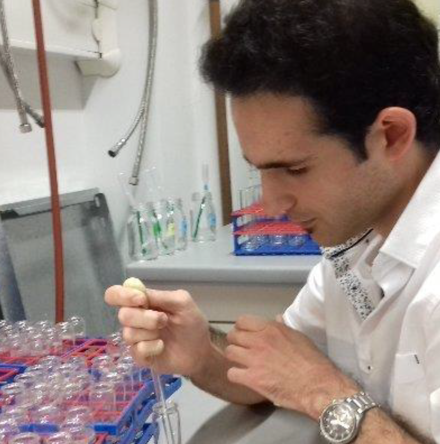{fig-alt="Florent Manzi"}

::: body
::: name
Dr. Florent Manzi
:::
::: role
Postdoc (2022–2024)
:::
::: thesis
Habitat choice: evolution and eco-evolutionary consequences
:::
:::
:::

::: card-ns
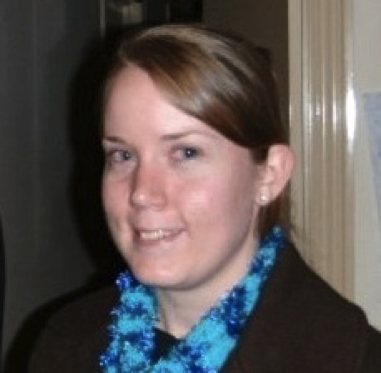{fig-alt="Kate Mitchell"}

::: body
::: name
Dr. Kate Mitchell
:::
::: role
Postdoc (2011–2012)
:::
::: thesis
Phenotypic plasticity in *Tetrahymena thermophila* ciliates
:::
::: now
Now postdoc @ Macquarie University (Australia)
:::
:::
:::

::: card-ns
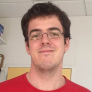{fig-alt="Thibaut Morel Journel"}

::: body
::: name
Dr. Thibaut Morel Journel
:::
::: role
Postdoc (2016–2018)
:::
::: thesis
The role of landscape topology on metapopulation dynamics under environmental
change: from *in silico* to *in vivo* approaches
:::
::: now
Now [associate professor at Sorbonne Paris Nord (France)](https://thibaut-morel-journel.fulltxt.net/)
:::
:::
:::

::: card-ns
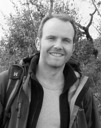{fig-alt="Frank Pennekamp"}

::: body
::: name
Dr. Frank Pennekamp
:::
::: role
PhD student (2009–2014)
:::
::: thesis
Swimming with ciliates — dispersal and movement ecology of *T. thermophila*
:::
::: now
Now [postdoc @ University of Zurich (Switzerland)](https://www.frank-pennekamp.info/)
:::
:::
:::

::: card-ns
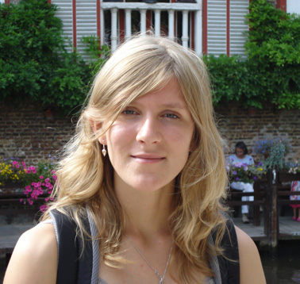{fig-alt="Viktoriia Radchuk"}

::: body
::: name
Dr. Viktoriia Radchuk
:::
::: role
PhD student (2008–2012) · Postdoc (2012–2013)
:::
::: thesis
Dealing with biological complexity in Population Viability Analysis: lessons from
two endangered butterfly species
:::
::: now
Now [senior researcher @ Leibniz Institute for Zoo and Wildlife Research (Germany)](https://www.viktoriiaradchuk.com/)
:::
:::
:::

::: card-ns
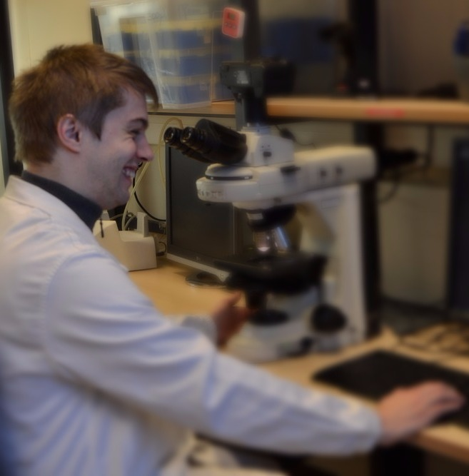{fig-alt="Nils Svendsen"}

::: body
::: name
Dr. Nils Svendsen
:::
::: role
PhD student (2016–2024)
:::
::: thesis
Relationships among functional traits in experimental microcosms of the protist
*Tetrahymena thermophila*
:::
:::
:::

::: card-ns
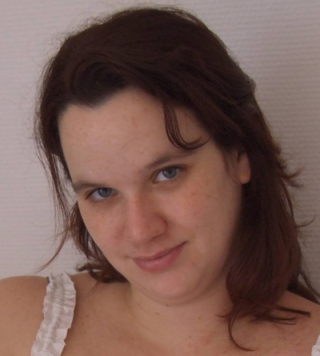{fig-alt="Virginie Thuillier"}

::: body
::: name
Virginie Thuillier
:::
::: role
PhD student (2011–2017)
:::
::: thesis
Phenotypic plasticity and evolution of life history traits of *Tetrahymena
thermophila* in microcosms
:::
:::
:::

::: card-ns
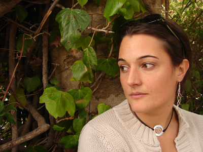{fig-alt="Camille Turlure"}

::: body
::: name
Dr. Camille Turlure
:::
::: role
PhD student (2007–2009) · Postdoc (2011–2015)
:::
::: thesis
Habitat from a butterfly's point of view: how specialist butterflies map onto
ecological resources
:::
::: now
Now Center of Excellence Manager — Medical Communication CoE @ Akkodis
:::
:::
:::

::: card-ns
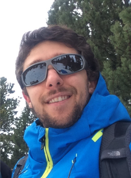{fig-alt="Allan Raffard"}

::: body
::: name
Dr. Allan Raffard
:::
::: role
Postdoc
:::
::: thesis
Intraspecific variability, dispersal syndromes and meta-ecosystem functioning
:::
:::
:::
:::

## Where are my mentees pursuing their career now?

{fig-alt="World map showing where former mentees now work"}
