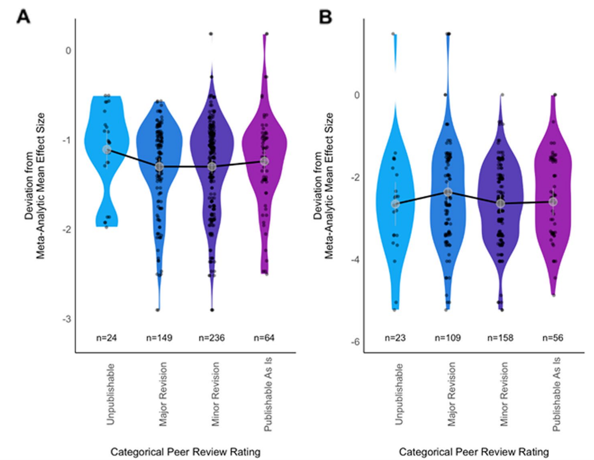

## Bibliometry



## Latest publication news

::: theme
::: {}
### New paper in [BMC Biology](https://bmcbiol.biomedcentral.com/articles/10.1186/s12915-024-02101-x)

**Same data, different analysts: variation in effect sizes due to analytical
decisions in ecology and evolutionary biology**

A large collaborative project showing how much the conclusions of an ecological
study can depend on the analytical choices made by the person analysing the data.
:::

{fig-alt="Cover figure of the BMC Biology paper"}
:::

## Full publication list — peer-reviewed articles



## Full publication list — peer-reviewed book chapters



::: note-box
**Reprints.** If you cannot access one of these papers,
[ask me for a reprint](#email?subject=Reprint%20request)
— I am always happy to send one.

:::

::: {style="text-align:center"}
[Full record on Google Scholar](https://scholar.google.be/citations?user=LH4kk5YAAAAJ&hl=en){.btn .btn-primary}
[Scopus](https://www.scopus.com/authid/detail.uri?authorId=6603405906){.btn .btn-outline-secondary}
[ResearchGate](https://www.researchgate.net/profile/Nicolas_Schtickzelle){.btn .btn-outline-secondary}
[Web of Science](https://www.webofscience.com/wos/author/record/B-5916-2014){.btn .btn-outline-secondary}
:::
