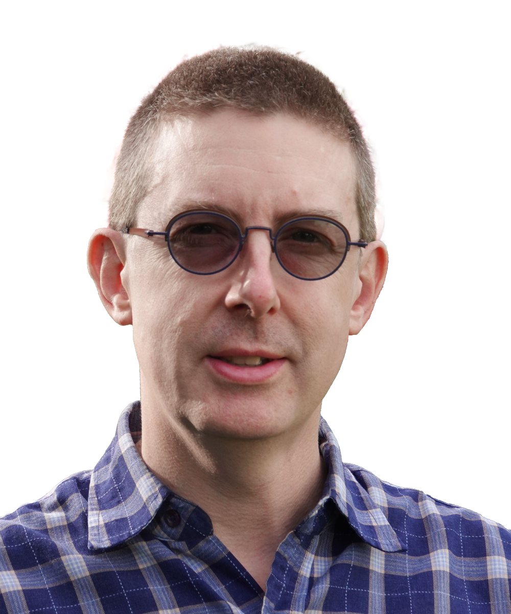

::: intro
{fig-alt="Portrait of Nicolas Schtickzelle"}

::: {}
I am a biologist, interested in understanding how nature works, passionate about
discovering natural landscapes and their living organisms across the world.

I am mainly studying how populations react to global change and how this affects
their long-term viability.

I am also interested in developing new methods for research in ecology and evolution.
:::
:::

## Career milestones

::: timeline
::: item
::: yr
2024 – today
:::
::: what
Full-time professor @ UCLouvain, and Honorary F.R.S.-FNRS Senior Research Associate
:::
:::

::: item
::: yr
2022 – today
:::
::: what
President of the School of Biology @ UCLouvain
:::
:::

::: item
::: yr
2021 – today
:::
::: what
President of the Council of the Earth and Life Institute @ UCLouvain
:::
:::

::: item
::: yr
2021 – 2024
:::
::: what
Head of the Ecology and Biodiversity section of the Earth and Life Institute @ UCLouvain
:::
:::

::: item
::: yr
2018 – 2024
:::
::: what
F.R.S.-FNRS Senior Research Associate @ UCLouvain
:::
:::

::: item
::: yr
2017 – 2024
:::
::: what
President of the APERFU, the association of tenured F.R.S.-FNRS researchers @ UCLouvain
:::
:::

::: item
::: yr
2015 – 2024
:::
::: what
Part-time professor @ UCLouvain
:::
:::

::: item
::: yr
2010 – 2016
:::
::: what
President of the Biodiversity Research Centre @ UCLouvain
:::
:::

::: item
::: yr
2008 – 2009
:::
::: what
Academic secretary of the Department of Biology @ UCLouvain
:::
:::

::: item
::: yr
2007 – 2018
:::
::: what
F.R.S.-FNRS Research Associate @ UCLouvain
:::
:::

::: item
::: yr
2007 – 2015
:::
::: what
Part-time lecturer @ UCLouvain
:::
:::

::: item
::: yr
2005
:::
::: what
Postdoc stay (3 months) with Prof. Thomas P. Quinn, University of Washington, Seattle, USA
:::
:::

::: item
::: yr
2004
:::
::: what
Postdoc stay (6 months) with Dr. Jean Clobert, Université Paris 6, France
:::
:::

::: item
::: yr
2003 – 2007
:::
::: what
F.R.S.-FNRS Postdoctoral researcher with Prof. Michel Baguette @ UCLouvain
:::
:::

::: item
::: yr
2003
:::
::: what
PhD in Biology, UCLouvain, Belgium — supervisors Prof. Michel Baguette & Prof. Eric Le Boulengé
:::
:::

::: item
::: yr
2001
:::
::: what
Visiting researcher (4 months, Marie Curie grant) @ UFZ Leipzig, Germany
:::
:::

::: item
::: yr
1999
:::
::: what
Master of advanced studies in Biology, UCLouvain, Belgium
:::
:::

::: item
::: yr
1997
:::
::: what
Master in Biology, UCLouvain, Belgium
:::
:::
:::
