

Besides mentoring individuals, I also very much like to share my knowledge through
teaching.

I nourish my lectures using up-to-date research results but also favour interactive
learning and critical mind, a point I believe to be more essential than ever in a
world where information access is not anymore the challenge but where its synthesis
and filtering are.

I currently teach courses to BSc and MSc students in Biology @ UCLouvain covering
statistics for biology, conservation biology, and field ecology. I am proud my
courses receive very positive assessments from students.

## Courses

::: course
### Statistical principles and analysis of biological data — LBIO1283

::: meta
BSc Biology, 3rd year · 4 ECTS
:::

The student shall understand, and become able to use correctly and critically the
principal methods for the statistical analysis of biological and environmental
data. He or she perceives the relationship between experimental design and analysis
model and the necessity of planning experiments ahead, and becomes familiar with
computer-aided data analysis.

After completing this course, the student should master the basic methods for the
analysis of biological data, be able to choose the analysis model and method best
adapted to the design of simple factorial experiments, and to analyse and interpret
correctly the results of such experiments. They should then be able to further
progress by themselves and follow fruitfully advanced lectures on experimental
design and data analysis.

::: gallery
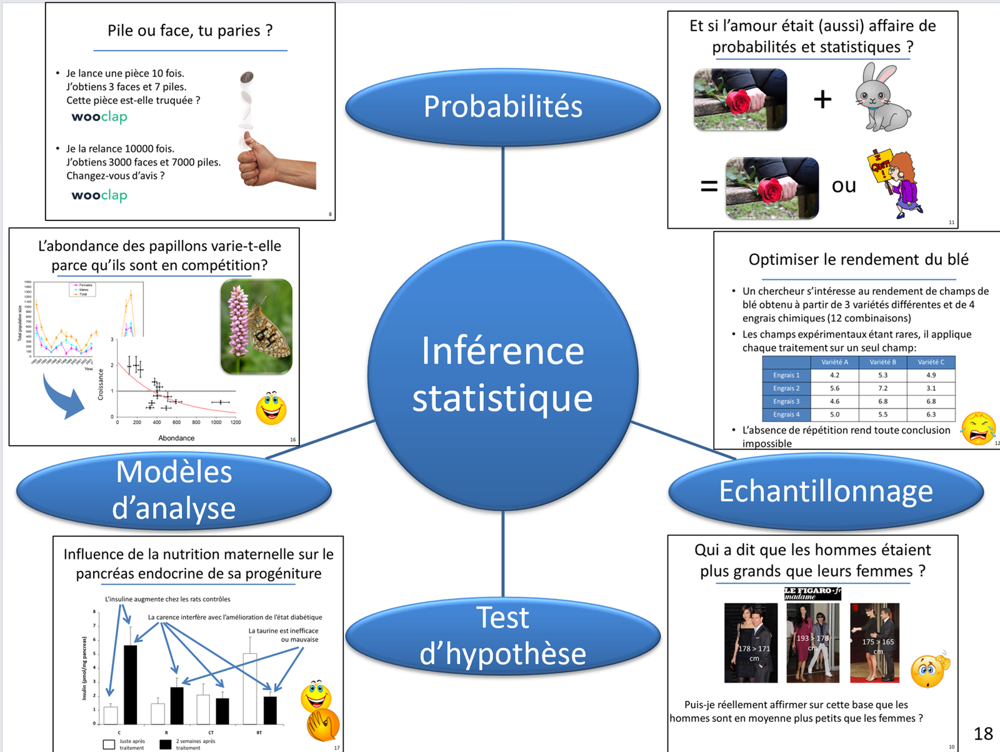{fig-alt="LBIO1283 course slide"}
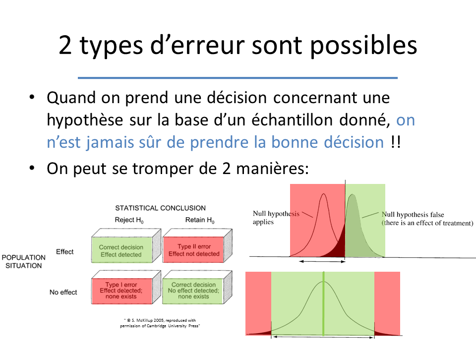{fig-alt="LBIO1283 course slide"}
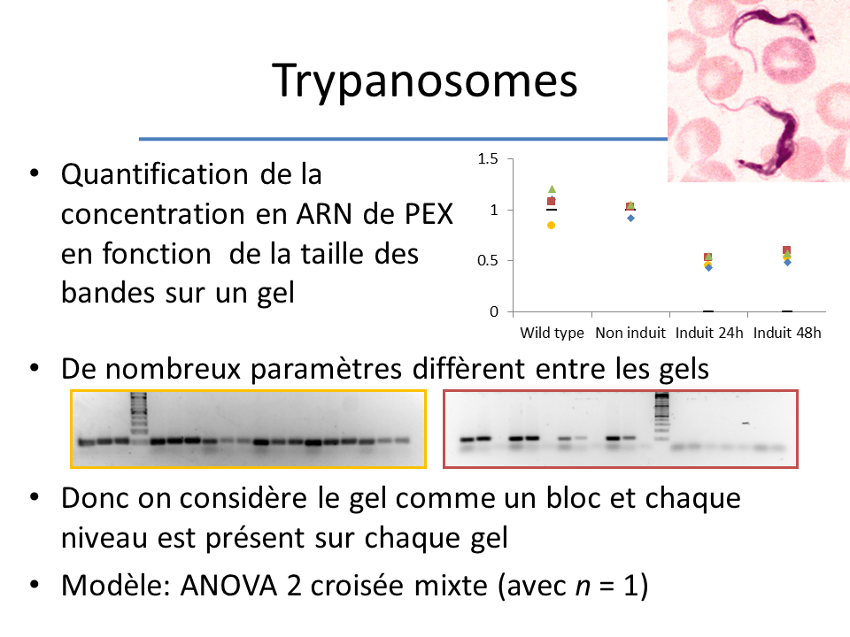{fig-alt="LBIO1283 course slide"}
:::
:::

::: course
### Biodiversity conservation — LBOE2120

::: meta
MSc Biology, 1st year · 4 ECTS
:::

The course emphasizes a multi-disciplinary approach to conservation biology
integrating ecology, biogeography and genetics, leading to a modelling approach.
It then covers the applied aspect of this discipline, integrating political and
socio-economic thinking.

The course begins by defining the levels of biodiversity, its spatiotemporal
variations and its current state. The peculiarity of the current extinction crisis
is determined relative to the extinctions of the past. Then the various threats to
biodiversity, caused by human impacts on the environment, are detailed, with the
associated risks to biodiversity and humanity. This is followed by an overview of
approaches to conservation and management of territories and threatened species.

A visit to the UCLouvain research forest (Bois de Lauzelle) provides real world
illustrations of the risks posed to biodiversity and some associated conservation
and restoration approaches.

::: gallery
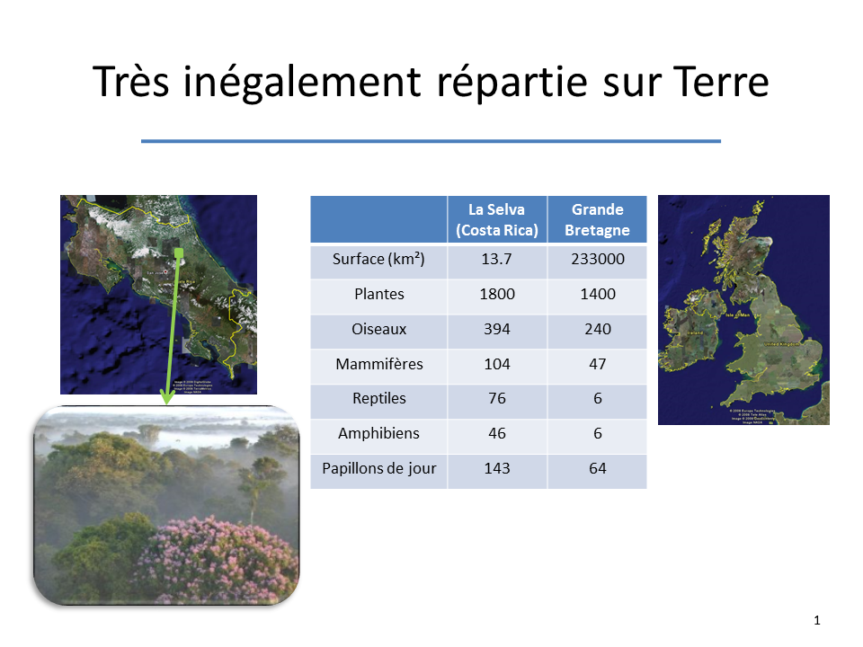{fig-alt="LBOE2120 course slide"}
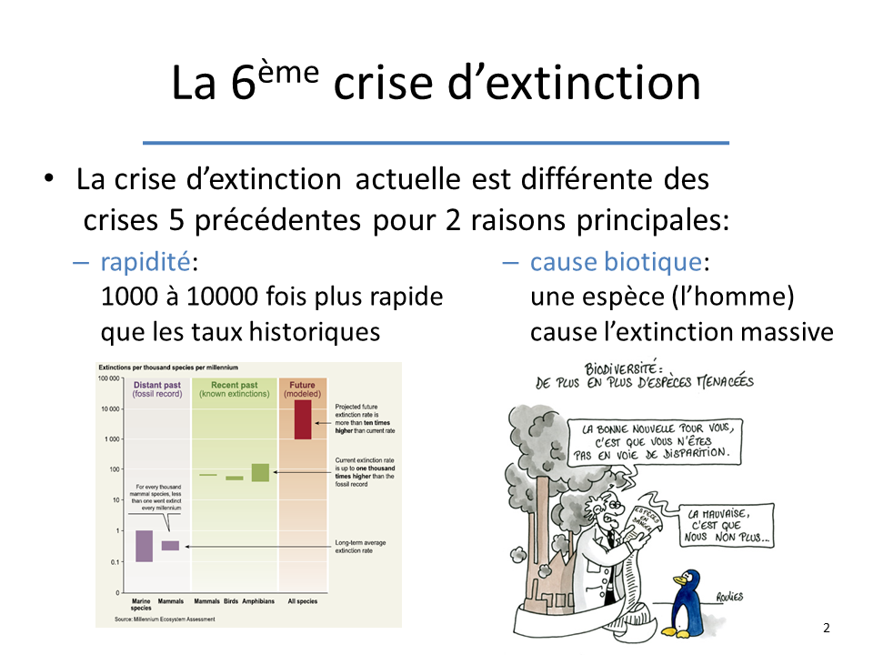{fig-alt="LBOE2120 course slide"}
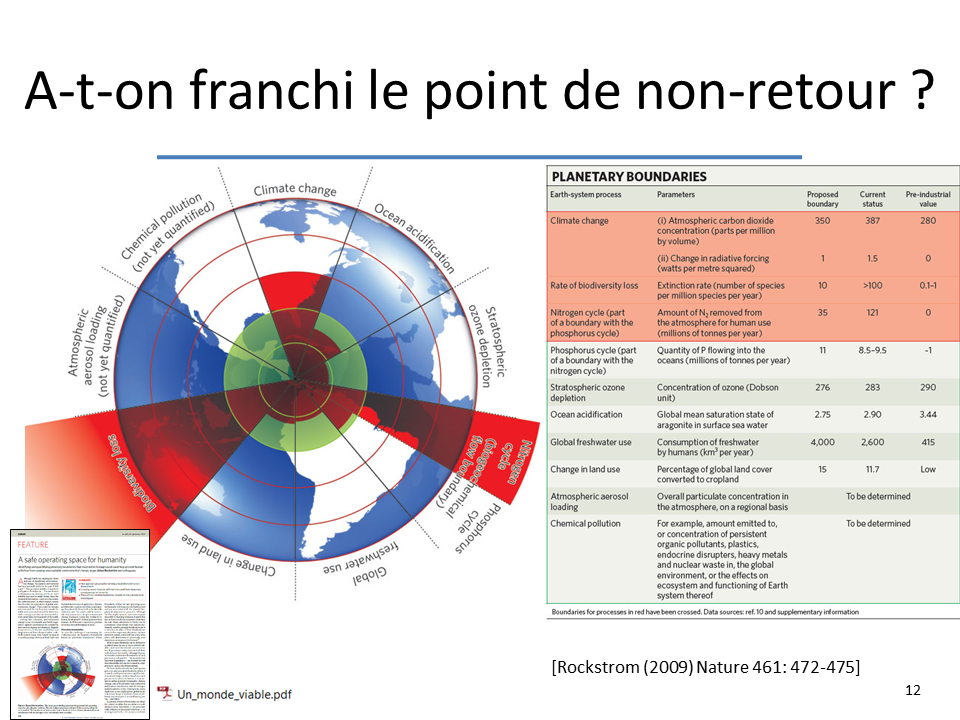{fig-alt="LBOE2120 course slide"}
:::
:::

::: course
### Scientific approach in biology — LBIO1116

::: meta
BSc Biology, 1st year · 4 ECTS (partim)
:::

The course develops several aspects of the scientific approach in biology: the
deductive and inductive methods, acquiring and checking experimental and
observational data, and finding and analyzing scientific information. Emphasis is
put on the development of critical thinking.

In this two-teacher course, I specifically focus on scientific data: through
interactive activities, students explore the different sources of variation in
data, learn how to properly develop ad-hoc data validation checks, how to visualize
their data and perform descriptive statistics. I also supervise a practical project
where students learn to develop and apply an experimental protocol.

::: gallery
{fig-alt="LBIO1116 course slide"}
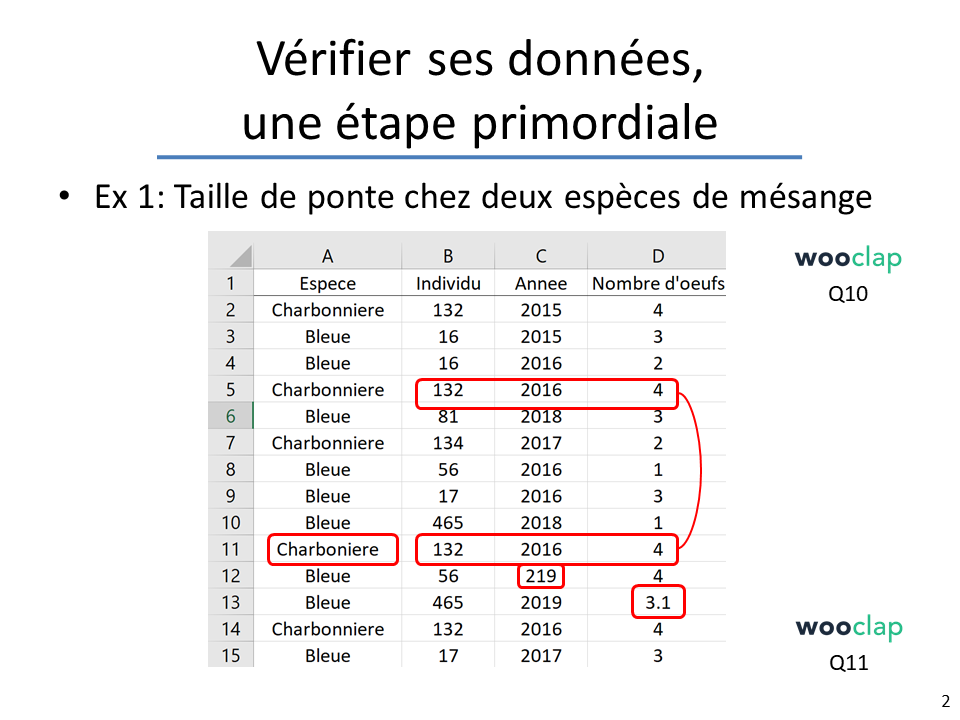{fig-alt="LBIO1116 course slide"}
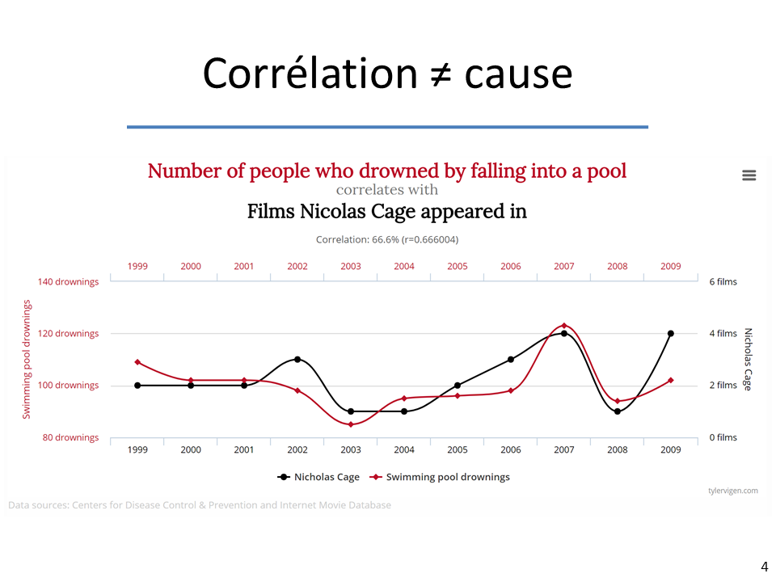{fig-alt="LBIO1116 course slide"}
:::
:::

::: course
### Data analysis and modeling of biological systems — LBOE2112

::: meta
MSc Biology, 1st year · 5 ECTS (partim)
:::

I teach the module "Multivariate data analysis" of this course. Emphasis is put on
the understanding and critical application of multivariate statistics as tools for
research in ecology. I focus on the importance of data visualization, data checking
and determining the best analysis approach for each specific case study. I insist on
the risks associated with performing statistical analyses using R packages without
understanding the necessary input parameters and checking their default values.

::: gallery
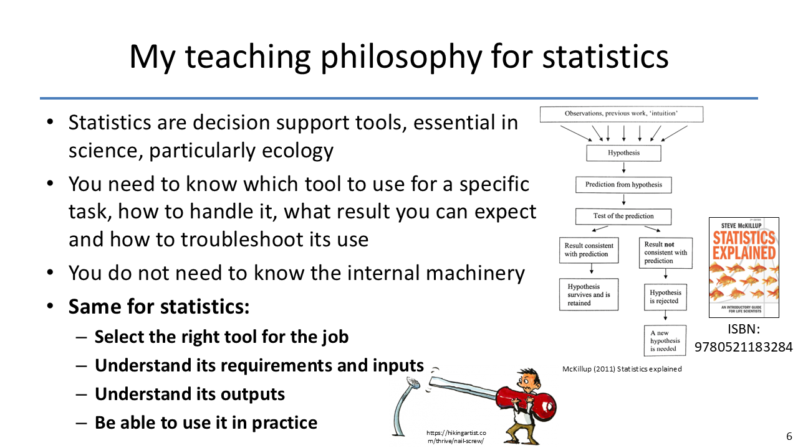{fig-alt="LBOE2112 course slide"}
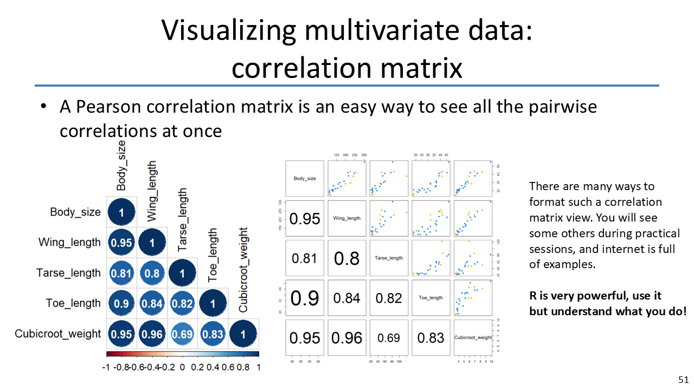{fig-alt="LBOE2112 course slide"}
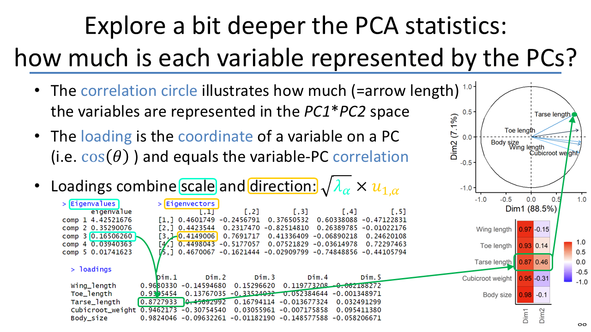{fig-alt="LBOE2112 course slide"}
:::
:::
